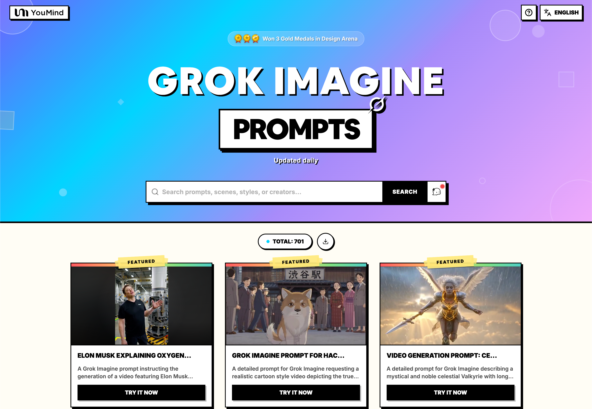

[](README.md) [](README_zh.md) [](README_zh-TW.md) [](README_ja-JP.md) [](README_ko-KR.md) [](README_th-TH.md) [](README_vi-VN.md) [](README_hi-IN.md) [](README_es-ES.md) [-Click%20to%20View-lightgrey)](README_es-419.md) [](README_de-DE.md) [](README_fr-FR.md) [](README_it-IT.md) [-Click%20to%20View-lightgrey)](README_pt-BR.md) [](README_pt-PT.md) [](README_tr-TR.md)

---

# 🎬 Prompts de Vídeo Grok Imagine Incríveis

[](https://awesome.re)
[](https://github.com/YouMind-OpenLab/awesome-grok-imagine-prompts)
[](https://creativecommons.org/licenses/by/4.0/)
[](https://github.com/YouMind-OpenLab/awesome-grok-imagine-prompts/pulls)

Uma coleção curada de prompts de geração de vídeo de alta qualidade para o Grok Imagine da xAI

> ⚠️ **Copyright Notice**: All prompts are collected from the community for educational purposes. If you believe any content infringes on your rights, please [open an issue](https://github.com/YouMind-OpenLab/awesome-grok-imagine-prompts/issues/new) and we will remove it promptly.

---

## 📖 Table of Contents

- [🌐 View in Web Gallery](#-view-in-web-gallery)
- [🤔 What is Grok Imagine?](#-what-is-grok-imagine)
- [📊 Statistics](#-statistics)
- [⭐ Featured Prompts](#-featured-prompts)
- [🎬 All Prompts](#-all-prompts)
- [🤝 How to Contribute](#-how-to-contribute)
- [📄 License](#-license)
- [🙏 Acknowledgements](#-acknowledgements)
- [⭐ Star History](#-star-history)

---

## 🌐 View in Web Gallery

<div align="center">



</div>

**[👉 Browse all Grok Imagine prompts on YouMind](https://youmind.com/grok-imagine-prompts)**

Why use our gallery?

| Feature | GitHub README | youmind.com Gallery |
|---------|--------------|---------------------|
| 🎬 Video Playback | ❌ Static thumbnails only | ✅ Full video playback with streaming |
| 🔍 Search | Ctrl+F only | Multi-field fuzzy matching search |
| 🤖 AI Recommendation | - | AI-powered prompt recommendations |
| 📱 Mobile | Basic | Fully responsive |

---

## 🤔 What is Grok Imagine?

**Grok Imagine** is a video generation model by **xAI**, integrated into the Grok AI assistant on X (Twitter). It generates high-quality, cinematic videos from text prompts and images with stunning visual quality.

**Key Features:**
- 🎬 **Text-to-Video** — Generate videos from text descriptions
- 🖼️ **Image-to-Video** — Animate static images into dynamic videos
- ✂️ **Video Editing** — Edit and transform existing videos
- 🔊 **Auto Audio** — Automatic dubbing and background music
- 📐 **720p+ Resolution** — 10-15 seconds duration per clip
- ⚡ **Fast Generation** — Under 20 seconds generation time

---

## 📊 Statistics

| Metric | Count |
|--------|-------|
| 📝 Total Prompts | **3080** |
| ⭐ Featured Prompts | **3** |
| 🔄 Last Updated | **2026-10-14** |

---

## 🔥 Featured Prompts

> ⭐ Hand-picked prompts with outstanding results

### No. 1: Elon Musk explicando a circulação de oxigénio no motor da SpaceX


#### 📖 Description

Um prompt do Grok Imagine instruindo a geração de um vídeo com Elon Musk explicando a circulação de oxigênio dentro de um motor SpaceX.

#### 📝 Prompt

```
Usando Grok para gerar um de @elonmusk dando uma explicação no motor da SpaceX sobre a circulação de oxigênio.
```

#### 🎬 Video

<div align="center">


**[🎬 View Video →](https://youmind.com/grok-imagine-prompts?id=1377)**

</div>

#### 📌 Details

- **Author:** [CHINA PUNTER🇳🇬🇨🇳](https://x.com/CHINA_PUNTER)
- **Source:** [Twitter Post](https://x.com/CHINA_PUNTER/status/2033062400044445904)
- **Published:** March 15, 2026

**[👉 Try it now →](https://youmind.com/grok-imagine-prompts?id=1377)**

---

### No. 2: Prompt do Grok Imagine para o vídeo da vida de Hachiko


#### 📖 Description

Um prompt detalhado para Grok Imagine solicitando um vídeo em estilo de desenho animado realista que retrate a verdadeira história da vida de Hachiko na Tóquio da década de 1920, incluindo sua adoção, caminhadas diárias, a morte do Professor Ueno e a espera fiel de Hachiko.

#### 📝 Prompt

```
Vídeo em estilo desenho animado realista da verdadeira vida de Hachiko na Tóquio dos anos 1920: o filhote de Akita nascido em 1923 em Ōdate, adotado pelo Professor Ueno em 1924, suas caminhadas diárias até a Estação Shibuya, a morte súbita de Ueno em 1925 por hemorragia cerebral, e a espera real e fiel de Hachiko todos os dias por quase 10 anos até sua morte em 1935, em meio a multidões e estações.
```

#### 🎬 Video

<div align="center">


**[🎬 View Video →](https://youmind.com/grok-imagine-prompts?id=1428)**

</div>

#### 📌 Details

- **Author:** [Hachiko - $HACHI](https://x.com/HachikoS0L)
- **Source:** [Twitter Post](https://x.com/HachikoS0L/status/2033111579575591089)
- **Published:** March 15, 2026

**[👉 Try it now →](https://youmind.com/grok-imagine-prompts?id=1428)**

---

### No. 3: Prompt de geração de vídeo: Valquíria Celestial descendo à Terra na chuva


#### 📖 Description

Um prompt detalhado para Grok: Imagine descrever uma Valquíria celestial mística e nobre com longos cabelos prateados e armadura brilhante, segurando uma lança sagrada, descendo à Terra na chuva, emitindo uma aura solene e sagrada enquanto ela cai de Valhalla.

#### 📝 Prompt

```
Uma Valquíria celestial mística e nobre, uma mulher digna e bela com longos cabelos prateados e armadura brilhante, segurando uma lança sagrada, descendo à Terra no momento, com chuva torrencial, irradiando uma aura solene e sagrada enquanto é trazida de Valhalla em uma aparição fantástica.
```

#### 🎬 Video

<div align="center">


**[🎬 View Video →](https://youmind.com/grok-imagine-prompts?id=1454)**

</div>

#### 📌 Details

- **Author:** [Apple](https://x.com/makoto_so)
- **Source:** [Twitter Post](https://x.com/makoto_so/status/2033124612234686633)
- **Published:** March 15, 2026

**[👉 Try it now →](https://youmind.com/grok-imagine-prompts?id=1454)**

---

---

## 🎬 All Prompts

> 📝 Sorted by publish date (newest first)

### Prompt de Vídeo Grok Imagine: Criatura Alienígena Surreal


> Um prompt detalhado para o Grok Imagine gerar um retrato surreal de uma criatura alienígena com cabeças de polvo fundidas e características extremas de visão periférica.

#### 📝 Prompt

```
Retrato surreal de uma criatura alienígena: duas cabeças de polvo fundidas empilhadas, a cabeça superior grande com olhos enormes posicionados nas bordas extremas esquerda e direita da cabeça para máxima visão periférica e quase nenhum ponto cego, a cabeça inferior pequena...
```


**[🎬 View Video →](https://youmind.com/grok-imagine-prompts?id=12516)**

**Author:** [Ami A](https://x.com/AA63782) | **Source:** [Link](https://x.com/AA63782/status/2110251096585507200) | **Published:** Oct 14, 2026

---
### Prompt de Música Synthwave para Vídeo


> Um prompt detalhado de texto para música, projetado para uso em vídeos do Grok Imagine, para criar uma faixa synthwave cinematográfica.

#### 📝 Prompt

```
Synthwave cinematográfico com um toque futurista elegante, pulso de andamento médio envolvente, baixo analógico profundo, sintetizadores arpegiados cintilantes, baterias programadas impactantes e pads atmosféricos amplos. Produção neon brilhante com crescimentos dinâmicos, transientes nítidos e uma sensação fria e polida de movimento e energia noturna. Sem vocais.
```


**[🎬 View Video →](https://youmind.com/grok-imagine-prompts?id=12509)**

**Author:** [Lacey](https://x.com/LaceyPresley) | **Source:** [Link](https://x.com/LaceyPresley/status/2110243164166443138) | **Published:** Oct 14, 2026

---
### Vídeo de Dança com Glitch da Cybertruck


> Um prompt de vídeo surreal onde um personagem dança ao redor de uma Cybertruck e se transforma em pixels digitais.

#### 📝 Prompt

```
Sony dança ao redor da Cybertruck e começa a se transformar em pixels digitais, reaparecendo e desaparecendo em um vídeo de 2 segundos.
```


**[🎬 View Video →](https://youmind.com/grok-imagine-prompts?id=12513)**

**Author:** [kyle smith](https://x.com/RadCyberTruck) | **Source:** [Link](https://x.com/RadCyberTruck/status/2110229724962136221) | **Published:** Oct 14, 2026

---
### Prompt de Aventura no SpaceX Park


> Um prompt lúdico envolvendo os gatos Sir Crimson e Pearl em uma aventura no SpaceX New Earth Park.

#### 📝 Prompt

```
“As Patinhas que Oravam” 🙏🐾🐾🦴🦴

“ O Space X New Earth Park ” 
Sir Crimson e sua filha Pearl... Partem para uma grande aventura 🐾🦴🎢🚀🍔
```


**[🎬 View Video →](https://youmind.com/grok-imagine-prompts?id=12514)**

**Author:** [Restful_Path_777](https://x.com/Bchalk_777_777) | **Source:** [Link](https://x.com/Bchalk_777_777/status/2110204702314959303) | **Published:** Oct 14, 2026

---
### Cena de Ação-Comédia Retrô de Hong Kong


> Um prompt de vídeo altamente detalhado que recria uma cena de ação-comédia de Hong Kong dos anos 1990, com coreografia específica, cinematografia e descrições de personagens.

#### 📝 Prompt

```
Sujeito e Personagens: Uma cena de ação-comédia de Hong Kong dos anos 1990 com dois personagens:
Um assassino masculino intenso vestido com um paletó branco retrô, camiseta listrada em preto e branco, gravata preta e luvas sem dedos, segurando uma pistola negra equipada com supressor/silenciador destacável.
Uma jovem asiática surpresa com corte bob curto preto, vestindo uma blusa amarela vibrante sem mangas.
Cenário e Ambiente: Um espaço interior brilhante e minimalista, apresentando um banheiro e uma área de estar separados por uma porta giratória de painel amarelo. Paredes com azulejos limpos, iluminação de alto contraste e um esquema de cores predominantemente amarelo vibrante.
Sequência de Ação e Movimento:
00:00 – 00:11: Cortes dinâmicos alternando entre o assassino mirando dramaticamente sua pistola com silenciador e a mulher sentada casualmente no vaso sanitário na área do banheiro adjacente.
00:12 – 00:25: O assassino abaixa ligeiramente a arma e empurra contra a parede divisória central giratória amarela, fazendo-a abrir.
00:26 – 00:38: Em um timing cômico de slapstick, enquanto o painel amarelo gira, a mulher se levanta e caminha ao redor da porta rotativa para a sala adjacente, enquanto o assassino gira para o espaço que ela acabou de deixar—fazendo-os quase não se verem.
00:39 – 00:40: A mulher entra na cabine do banheiro pelo outro lado e senta-se novamente, exatamente quando o assassino se vira e aponta sua arma através do painel aberto diretamente de volta para ela.
Cinematografia e Estilo Visual:
Estilo: Filme de ação-comédia retrô de Hong Kong dos anos 1990, granulação de filme cinematográfica, paleta de cores saturadas em amarelo e branco, planos médios nítidos.
Movimento de Câmera: Cortes rápidos, enquadramento na altura dos olhos, pan horizontal estável seguindo a rotação da parede giratória.
```


**[🎬 View Video →](https://youmind.com/grok-imagine-prompts?id=12512)**

**Author:** [Rizi](https://x.com/Rizi_ru) | **Source:** [Link](https://x.com/Rizi_ru/status/2110187947819753643) | **Published:** Oct 14, 2026

---
### Extensão de Vídeo Relâmpago da Deusa Dianmu


> Um tweet compartilhando um prompt para gerar uma imagem de Dianmu (a deusa do relâmpago) e estendê-la em um vídeo de 20 segundos usando o Grok Imagine.

#### 📝 Prompt

```
Dianmu, a deusa que supostamente empunha relâmpagos à vontade; ela segura um espelho cintilante em cada mão. Por favor, forneça a imagem sem qualquer texto. ⚡
```


**[🎬 View Video →](https://youmind.com/grok-imagine-prompts?id=12520)**

**Author:** [華月光](https://x.com/hanagekkou) | **Source:** [Link](https://x.com/hanagekkou/status/2110184967989010876) | **Published:** Oct 14, 2026

---
### Prompt de Vídeo Grok Imagine: Conceito do Grok Blok


> Um prompt criativo para o Grok Imagine, projetando um dispositivo fictício chamado 'Grok Blok', inspirado no HomeView da Apple e no Cybertruck da Tesla.

#### 📝 Prompt

```
Com base na nova tela de mesa com IA Siri da Apple (HomeView), crie uma versão do Grok chamada Grok Blok com design inspirado no Cybertruck @grok
```


**[🎬 View Video →](https://youmind.com/grok-imagine-prompts?id=12515)**

**Author:** [Heather](https://x.com/HeatherNSB) | **Source:** [Link](https://x.com/HeatherNSB/status/2110173727203934430) | **Published:** Oct 14, 2026

---
### Sequência Cinematográfica: Encontro com Dinossauro


> Um prompt de vídeo detalhado com múltiplas tomadas, retratando um encontro tenso com um predador semelhante a um T-rex em uma selva envolta em névoa.

#### 📝 Prompt

```
0-3s: Close-up dela espiando por cima do tronco, respirando de forma superficial. Atrás dela, fora de foco, a silhueta de um dinossauro escuro e chifrudo emerge da névoa.
3-8s: Câmera avança lentamente enquanto um enorme predador escuro, com escamas e semelhante a um T-rex, se aproxima furtivamente, cravando as garras na lama. Vapor sai de suas narinas e flutua pela neblina. Sua expressão muda de medo para pânico.
8-11s: Extreme close-up do rosto dela: olhos arregalados e lacrimejantes, lábios trêmulos, uma única lágrima rolando pela bochecha suja de lama, respiração rápida e curta.
11-13s: Dissolve suave para uma tomada sobre o ombro, vista de trás dela, com a cabeça do dinossauro pairando bem perto.
13-15s: O dinossauro congela a centímetros de distância, então abre amplamente as mandíbulas, revelando fileiras de dentes, e solta um rugido ensurdecedor enquanto a cena permanece estática.
Áudio: Gotas de chuva, ambiente distante da selva, passos pesados com roncos graves, sua respiração ofegante e um rugido alto no final.
Prompt negativo: estilo cartoon, membros extras, rosto distorcido, texto, marca d'água, desfoque, baixa resolução.
```


**[🎬 View Video →](https://youmind.com/grok-imagine-prompts?id=12511)**

**Author:** [Rizi](https://x.com/Rizi_ru) | **Source:** [Link](https://x.com/Rizi_ru/status/2110171733839999253) | **Published:** Oct 14, 2026

---
### Prompt de Moda: Diane Thomas Joy em Terno Elegante


> Um prompt detalhado para gerar um vídeo de Diane Thomas Joy vestindo um terno burgundy de alta moda, incentivando o engajamento da comunidade.

#### 📝 Prompt

```
Diane Thomas Joy veste um vestido-terno burgundy de alta moda com sapatos combinando e acessórios modernos, incentivando o engajamento da comunidade para prosperar e crescer.
```


**[🎬 View Video →](https://youmind.com/grok-imagine-prompts?id=12517)**

**Author:** [Diane Thomas Joy](https://x.com/Thoma31928Joy) | **Source:** [Link](https://x.com/Thoma31928Joy/status/2110151441222606940) | **Published:** Oct 13, 2026

---
### Prompt para Animação em Loop de Chuva Digital Matrix


> Um prompt preciso para criar uma animação em loop perfeito de 15 segundos da chuva digital do Matrix, iniciando a partir de um quadro de imagem exato, preservando a paleta e os detalhes.

#### 📝 Prompt

```
Use esta imagem exata como o primeiro quadro literal de uma animação em loop perfeito de 15 segundos da chuva digital do Matrix. Preserve a proporção original, a composição exata, o fundo preto, a paleta de numerais monoespaçados “1” em verde-esmeralda e todos os detalhes dos pixels...
```


**[🎬 View Video →](https://youmind.com/grok-imagine-prompts?id=12519)**

**Author:** [_](https://x.com/ONKiChan1) | **Source:** [Link](https://x.com/ONKiChan1/status/2109962140056740262) | **Published:** Oct 13, 2026

---
### Prompt de Vídeo Grok Imagine: Aventura Neon Subaquática com Sydney Sweeney


> Um prompt de vídeo cinematográfico detalhado apresentando Sydney Sweeney em uma aventura de boate neon subaquática, com marcações específicas de tempo, iluminação e áudio.

#### 📝 Prompt

```
Prompt de Vídeo por IA — Aventura Neon Subaquática com Sydney Sweeney

Vídeo cinematográfico vertical 9:16, 10 segundos, estrelado por Sydney Sweeney como personagem principal, mantendo seus traços faciais reconhecíveis, cabelos loiros ondulados e sorriso expressivo. Ritmo ultra-rápido, transições whip-pan e cortes sincronizados com a batida aproximadamente a cada segundo.

0–2 segundos: Sydney Sweeney, vestindo um sleek wetsuit preto de mergulho livre com uma pequena câmera de ação presa à alça do peito, nada rapidamente através de águas turquesa cristalinas sobre areia branca. Raios de sol dançam sobre seu rosto enquanto a câmera a acompanha com movimento dinâmico subaquático.

2–4 segundos: Ela passa velozmente por recifes de corais vibrantes em direção a uma cortina cintilante de contas iridescentes. Uma rampa de velocidade dramática segue enquanto ela atravessa a cortina brilhante. A câmera faz um whip-pan para dentro de uma misteriosa caverna de coral escura, onde luz violeta ilumina a água ao redor.

4–6 segundos: Revelação explosiva de uma boate subaquática futurista cheia de lasers neon, strobes coloridos, óculos de sol luminosos em formato de estrela flutuando e peixes tropicais se movendo ritmicamente com a música. Sydney emerge através de um portal violeta brilhante enquanto luzes ciano, magenta e roxa iluminam seu rosto.

6–10 segundos: Sydney coloca óculos de sol oversized em formato de estrela neon, gira brincalhona na gravidade zero subaquática e ri enquanto bolhas e partículas brilhantes giram ao seu redor. A câmera circula-a rapidamente com zooms energéticos, whip-pans afiados e transições suaves de speed-ramp, terminando em um close-up dramático de seu rosto sorridente contra a boate vibrante.

Estilo visual: Filmagem cinematográfica hiper-realista, detalhes faciais realistas, aparência consistente do personagem, física subaquática realista, iluminação volumétrica, água turquesa vívida, destaques neon magenta e ciano, brilho violeta, partículas flutuantes, motion blur suave, alto contraste, estética premium de videoclipe, 24 fps.

Áudio: Música eletrônica dance energética, whooshes profundos subaquáticos, efeitos sonoros cintilantes e um bass drop durante a revelação da boate.

Continuidade: Mantenha Sydney Sweeney reconhecível e visualmente consistente em todas as cenas. Sem distorção facial, personagens duplicados, piscar de traços faciais, textos indesejados, logos ou marcas d'água.
```


**[🎬 View Video →](https://youmind.com/grok-imagine-prompts?id=12439)**

**Author:** [Rizi](https://x.com/Rizi_ru) | **Source:** [Link](https://x.com/Rizi_ru/status/2109874273607462953) | **Published:** Oct 13, 2026

---
### Aventura de Passeio das Patas em Oração


> Um prompt narrativo para um vídeo simulado de passeio envolvendo os personagens Sir Crimson e Daughter Pearl.

#### 📝 Prompt

```
“As Patas em Oração” 🙏🐾🐾🦴🦴

Passeio simulado “Journey To Tomorrow”. Sir Crimson e Daughter Pearl... uma grande aventura 🐾🦴🌎🪐
```


**[🎬 View Video →](https://youmind.com/grok-imagine-prompts?id=12510)**

**Author:** [Restful_Path_777](https://x.com/Bchalk_777_777) | **Source:** [Link](https://x.com/Bchalk_777_777/status/2109809814293598376) | **Published:** Oct 13, 2026

---
### Vídeo de Treino de Academia com Body Horror


> Um prompt complexo para gerar um vídeo realista de academia, apresentando um homem com crescimento muscular anormal e placas de metal embutidas, detalhando ângulos de câmera específicos, timing e elementos de horror sem gore.

#### 📝 Prompt

```
[Travamento de Referência]

Use o primeiro quadro gerado @1 como referência de forma e ambiente.

O homem tem aproximadamente 38 anos, corte militar (buzz cut), barba por fazer curta, sem camisa, vestindo shorts esportivos cinza-escuros com acabamento laranja e tênis cinza-preto.

Os ombros e as costas já apresentam massas musculares anormais desde o início; elas não devem crescer novamente durante o vídeo.

Da escápula esquerda às costelas há uma protrusão vertical, assimétrica e massiva; o ombro direito apresenta saliências musculares menores e em camadas.

A superfície da massa esquerda possui duas fissuras escuras roxas semelhantes a feridas, com bordas enrugadas e irregulares.

As massas têm peso real, comprimem-se ligeiramente com a contração muscular e não podem inflar como balões.

Sem jatos de sangue, explosão de tecidos ou membros extras.

[Estilo & Câmera]

Vertical 9:16, gravação contínua de smartphone de 12 segundos.

O filmador fica cerca de dois metros atrás e à esquerda do homem, filmando na altura do peito.

Começa com um ângulo traseiro de dois terços, mostrando as massas dos ombros/costas, os braços e a barra EZ simultaneamente.

Ligeira tremedeira de mão, pequenos ajustes de enquadramento, sem órbita, sem cortes, sem câmera lenta.

Gravação comum de academia antiga: luzes fluorescentes planas, ruído leve, artefatos de compressão, reflexos de suor, desfoque de movimento natural.

Sem iluminação de filme de terror, sem música de fundo.

[Ambiente & Adereços]

Academia antiga no porão de um condomínio, pilares brancos, rodapé verde-claro, piso cinza desgastado, banco de treino vermelho, rack de halteres, ventilador de parede.

Um entusiasta do fitness adulto ao fundo, vestido com roupas cinzas, continua treinando, sem encarar, sem gritar.

O protagonista segura a mesma barra EZ com as duas mãos, com número fixo de anilhas pretas em ambos os lados.

[0–4s | Completando a Rosca]

O homem fica firme, cotovelos próximos ao corpo, levanta a barra do quadril até o peito.

Os antebraços dobram primeiro, os bíceps se contraem subsequentemente.

A grande protrusão nas costas comprime-se ligeiramente sob a tensão dos ombros, as posições das feridas permanecem inalteradas.

Ele olha para baixo na barra, expressão tensa, exalação curta.

O celular ajusta-se ligeiramente, mantendo o ombro/costas anormais e a ação de rosca dentro do quadro.

[4–7s | Descida Lenta]

O homem controla a descida da barra até que os braços fiquem quase esticados.

Os tecidos moles dos ombros/costas afundam e oscilam ligeiramente ao liberar a tensão, depois estabilizam.

Suor escorre pela pele.

Não pode encolher subitamente para um físico normal, nem adicionar novas massas.

[7–10s | Finalizando o Treino]

Ele dobra os joelhos, inclina-se para frente, coloca a barra no chão antes dos pés.

As anilhas tocam o chão primeiro, então ele solta a pegada.

Um som metálico surdo é ouvido uma vez.

O celular segue para baixo naturalmente, depois volta para o tronco.

O homem endireita-se, respirando pesadamente.

[10–12s | Percebe que Está Sendo Filmado]

O homem vira a cabeça para olhar para a câmera, girando os ombros para uma posição frontal.

Braços pendurados, silhueta anormal ainda visível.

Sem pânico, sem fuga. Apenas reconhecimento silencioso.

Corte abrupto.

[Continuidade & Restrições]

Consistência física entre quadros obrigatória.

Nenhuma mudança súbita de tamanho ou forma das massas.

Nenhum elemento sobrenatural além da anatomia distorcida.

Tom documental, não cinematográfico.
```


**[🎬 View Video →](https://youmind.com/grok-imagine-prompts?id=12444)**

**Author:** [John](https://x.com/john87445528) | **Source:** [Link](https://x.com/john87445528/status/2109803808867922199) | **Published:** Oct 13, 2026

---
### Vídeo de Planes Trains Autos com Reynolds e Gillis


> Prompt de vídeo do Grok Imagine recriando a cena do hotel de 'Planes, Trains and Automobiles' com Ryan Reynolds e Shane Gillis.

#### 📝 Prompt

```
Ryan Reynolds e Shane Gillis como Steve Martin e John Candy na cena do hotel de Planes Trains and Automobiles
```


**[🎬 View Video →](https://youmind.com/grok-imagine-prompts?id=12441)**

**Author:** [Redacticus](https://x.com/BillDeWaal) | **Source:** [Link](https://x.com/BillDeWaal/status/2109781218048835891) | **Published:** Oct 12, 2026

---
### Vídeo de Meme de Restaurante: Tofu Seco em Forma de Sola de Sapato


> Um prompt para criar um vídeo vertical humorístico de 10 segundos em um restaurante, onde um cliente pega um tofu seco que parece uma sola de sapato e interage com um garçom.

#### 📝 Prompt

```
[Configuração Geral]

10 segundos, formato vertical 9:16, filmagem casual realista com smartphone em um restaurante, tomada única.

A imagem redesenhada enviada serve como referência do quadro final, fixando a forma do tofu seco em formato de sola de sapato, a posição de agarre, o layout da mesa, a aparência do garçom e a composição final.

[Cena e Relação de Filmagem]

Restaurante chinês pequeno e comum, luzes pendentes quentes, mesas bege, clientes comendo e conversando naturalmente ao fundo.

Em primeiro plano, há uma grande tigela branca contendo óleo de pimenta, tofu seco, macarrão e vegetais, com uma tigela de sopa, bule e caixa de lenços de papel por perto.

Um homem adulto sentado segura o celular com a mão esquerda e usa dois hashis de madeira na mão direita para pegar comida. Apenas a mão que pega entra no quadro; o rosto e o corpo do homem permanecem fora da tela.

O garçom veste uma blusa preta e avental vinho, posicionado no lado direito, do outro lado da mesa.

Leve tremor de câmera manual, exposição natural interna, qualidade de compressão típica de celular, sem filtro de beleza, sem colorização cinematográfica.

[Prop Chave]

Apenas uma peça de tofu seco em forma de sola de sapato: marrom-amarelada, fatia fina, superfície coberta com óleo de pimenta e cebolinha, padrão de grade claro, contorno consistente com o quadro final.

É um alimento flexível, não uma sola de sapato real, não aparecem cabedal, borracha ou sapatos.

Os hashis seguram a extremidade superior do tofu, pontos de contato precisos, a extremidade inferior pende naturalmente quando levantada.

[Estrito Storyboard Temporal]

0–2s:

Câmera ligeiramente voltada para baixo em direção à tigela do prato. A mão direita do homem entra pela esquerda, usando dois hashis de madeira para segurar a extremidade superior da peça de tofu na tigela.

Tofu parcialmente submerso no óleo de pimenta, contorno ainda não totalmente revelado.

2–4.5s:

Homem levanta os hashis lentamente para cima.

Peça inteira de tofu continuamente extraída da tigela, revelando primeiro a extremidade superior, depois o padrão de grade, seção média estreitada e parte inferior arredondada, apresentando gradualmente a forma completa de sola de sapato.

Tofu balança suavemente, duas ou três gotas de molho caem de volta na tigela.

Câmera sobe ligeiramente junto com a mão que segura, mantendo a peça inteira de tofu dentro do quadro.

4.5–6s:

Homem para os hashis, parecendo examinar a comida de perto, murmura desconfiado:

"Este tofu seco..."

Garçom ouve o som, aproxima-se ligeiramente do outro lado da mesa, olhar muda dos hashis para o tofu.

6–9s:

Homem mantém o agarre, exibe gentilmente o tofu para o garçom, pergunta:

"Garçom, por que isso parece uma sola de sapato?"

Tom natural, confuso, ligeiramente incrédulo, não gritando acusações.

Garçom olha para baixo, sobrancelhas se franzem gradualmente, lábios se apertam levemente, pausa, não responde imediatamente.

Tofu ainda suspenso acima da tigela, não toca o garçom.

9–10s:

Câmera repousa sobre a peça completa de tofu e a reação perplexa do garçom.

Hashis, tofu, utensílios e posições do garçom alinham-se com a referência do quadro final, mantêm por pelo menos um segundo, deixando uma pausa cômica silenciosa.

[Som]

Voz falante natural de homem adulto, originária perto da câmera.

Retenha sons de hashis batendo levemente na borda da tigela, pingar de molho, conversa de volume baixo das mesas vizinhas e tilintar de utensílios.

Sem narração, sem música de fundo, sem efeitos sonoros exagerados de comédia.

[Continuidade & Restrições]

Deve agarrar antes de levantar, tofu emerge ao longo de trajetória contínua da tigela, sem teletransporte, sem duplicação.

Mantenha mesma forma, tamanho, padrão de grade e cor antes e depois de levantar.

Mantenha dois hashis, não perfure a comida, não deforme; dedos normais.

Garçom apenas se aproxima e observa naturalmente, não arranca a comida, não grita prematuramente.

Sem cortes, sem zoom súbito, sem câmera lenta, sem adicionar sapatos ou outros props explicativos.

Saída gerada não deve incluir texto, marcas d'água ou interfaces de plataforma.
```


**[🎬 View Video →](https://youmind.com/grok-imagine-prompts?id=12443)**

**Author:** [John](https://x.com/john87445528) | **Source:** [Link](https://x.com/john87445528/status/2109720765776162888) | **Published:** Oct 12, 2026

---
### Análise do Corvette pelo Bulldog Francês Yeti


> Um prompt de vídeo divertido para o Grok Imagine, apresentando um bulldog francês chamado Yeti analisando um Corvette conversível de 1966.

#### 📝 Prompt

```
Yeti, o bulldog francês, faz uma análise automotiva de um Corvette conversível de 1966 na cor Mossport Green. #frenchbulldog #corvette #dog #carreview
```


**[🎬 View Video →](https://youmind.com/grok-imagine-prompts?id=12440)**

**Author:** [Howard Gilson](https://x.com/Howard4S) | **Source:** [Link](https://x.com/Howard4S/status/2109713321830371593) | **Published:** Oct 12, 2026

---
### Prompt de Vídeo Cowboy Sam Elliott


> Um prompt detalhado para o Grok Imagine gerar um vídeo fotorrealista de Sam Elliott como cowboy, montando a cavalo e conduzindo gado.

#### 📝 Prompt

```
Vídeo fotorrealista de Sam Elliott montando a cavalo e conduzindo um grupo de gado pelas planícies e pelo deserto. Na última cena, a câmera faz uma panorâmica até Sam, que sorri e inclina levemente seu chapéu de cowboy. Sem diálogo, apenas música country.
```


**[🎬 View Video →](https://youmind.com/grok-imagine-prompts?id=12438)**

**Author:** [Carry Robey](https://x.com/carry_robey) | **Source:** [Link](https://x.com/carry_robey/status/2109648322424164530) | **Published:** Oct 12, 2026

---
### OVNI Alienígena Sobre Megacidade Neon


> Um prompt cinematográfico detalhado descrevendo um enorme OVNI alienígena pairando sobre uma megacidade neon ao entardecer, usado para comparar o Grok Imagine com outros geradores de imagens por IA.

#### 📝 Prompt

```
Um enorme OVNI alienígena ultratecnológico pairando ameaçadoramente acima de uma vasta megacidade neon ao entardecer, seu casco escuro de obsidiana repleto de arrays de armas brilhantes e propulsores angulares, feixes de varredura vermelhos sinistros cortando para baixo enquanto anéis de energia pulsantes se propagam do seu núcleo. Renderização CGI futurista 3D, paleta de ciano elétrico e magenta com pretos profundos do vazio e acentos brancos luminosos, raios volumétricos de Deus perfurando névoa tóxica, profundidade em camadas intrincada com superfícies metálicas reflexivas e estalos de energia. Plano cinematográfico de dolly em ângulo baixo subindo dramaticamente para enfatizar a escala colossal, movimento lento e suave da câmera orbitando com sutil flare de lente.
```


**[🎬 View Video →](https://youmind.com/grok-imagine-prompts?id=12445)**

**Author:** [AI Aimee](https://x.com/RockGrokAI) | **Source:** [Link](https://x.com/RockGrokAI/status/2109615817902129155) | **Published:** Oct 12, 2026

---
### Prompt de Vídeo de Dança de Dupla Zumbi


> Um prompt detalhado para gerar um vídeo de dança vertical de Halloween com uma dupla de zumbis de 15 segundos usando o Grok Imagine. Inclui restrições rigorosas sobre as posições dos dançarinos, travas de aparência para evitar maquiagem de terror e instruções específicas de zoom da câmera sincronizadas com a batida.

#### 📝 Prompt

```
Dança de Dupla Zumbi de Halloween | 9:16 Vertical | Dois Dançarinos | Fundo Fixo | Câmera Fixa | Zoom e Close-Up Sincronizados com a Batida | Horror Trap Hip-Hop

MÚSICA / ENERGIA:
Uma batida intensa que entra abruptamente desde o início, horror trap hip-hop a 155 BPM. Baterias pesadas, baixo profundo, alta velocidade, acentos afiados, energético e dinâmico.

TRAVA ABSOLUTA:
Exatamente dois dançarinos apenas. O Dançarino A permanece sempre à ESQUERDA, o Dançarino B permanece sempre à DIREITA. Mesmos rostos, corpos, penteados, roupas, posições, fundo, iluminação, cores e sombras durante todo o vídeo. Sem trocas, sem cruzar lugares, sem deformações, sem dançarinos extras, sem cortes. O fundo nunca muda.

Dança Zumbi (Prioridade Máxima):
Ambos os dançarinos estendem os braços diretamente à frente na altura dos ombros, dobram os pulsos precisamente 90 graus para baixo e espalham os dedos naturalmente e retos, liberando uma "dança zumbi" incrivelmente rápida, agressiva e de alta energia. A performance apresenta uma sequência de movimentos incluindo "passos zumbi" rápidos com pernas rígidas, ações explosivas dos ombros, pops intensos no peito, movimentos afiados da cabeça, levantamentos poderosos dos joelhos, agachamentos com joelhos abertos, avanços súbitos e tremores corporais vigorosos e rítmicos.

Use footwork em DOUBLE-TIME a 155 BPM, aceleração rápida, congelamentos abruptos, reinícios explosivos e acentos fortes na batida.
Inclua algumas seções onde ambos os dançarinos realizam movimentos de dança diferentes ao mesmo tempo, mantendo a pose permanente do braço de zumbi.

REGRA DA DANÇA EM DUPLA:
Esta é uma dança em dupla, mas eles não devem estar perfeitamente sincronizados o tempo todo.
Eles se movem no mesmo ritmo geral, mas com leves deslocamentos de tempo, acentos alternados e ações corporais diferentes.

FINALIZAÇÃO:
Os dois assumem uma pose de zumbi, e a câmera faz um zoom para um close-up de seus olhos brilhando em vermelho enquanto encaram a câmera.

TRAVA DE APARÊNCIA — PRIORIDADE ABSOLUTA:
Preserve exatamente os rostos originais dos dois dançarinos, tons de pele naturais, penteados e maquiagem conforme mostrados no quadro inicial. Sem maquiagem de zumbi, maquiagem de terror, maquiagem de cadáver, pele pálida ou cinza, órbitas oculares escurecidas, descoloração facial ou efeitos faciais grotescos. Sem sangue, sangue falso, sangramento, feridas, cicatrizes, hematomas ou lesões visíveis. Expresse o personagem zumbi exclusivamente através de movimentos corporais rígidos, inclinações antinaturais da cabeça, passos arrastados, impactos afiados nos ombros e expressões faciais perturbadoras. Não altere a aparência de nenhum dos dançarinos durante todo o vídeo.

CÂMERA:
Somente câmera frontal fixa. Sem movimento de câmera, sem pan, sem tilt, sem dolly.
Use apenas zooms ópticos rápidos sincronizados com a batida, snap zoom-outs e enquadramentos breves de close-up punch-in para criar velocidade e impacto, mantendo a posição da câmera fixa. Mantenha o mesmo fundo o tempo todo.
```


**[🎬 View Video →](https://youmind.com/grok-imagine-prompts?id=12446)**

**Author:** [SPLASH GIRLS@AI Image](https://x.com/splash_GL) | **Source:** [Link](https://x.com/splash_GL/status/2109615069470556358) | **Published:** Oct 12, 2026

---
### Montanha-Russa na Lua POV


> Um prompt de vídeo cinematográfico em primeira pessoa (POV) de um passeio de montanha-russa que começa na superfície da Lua.

#### 📝 Prompt

```
POV Cinematográfico: Um emocionante passeio de montanha-russa em primeira pessoa começa na superfície desolada da Lua, suspenso acima da escuridão infinita do espaço. A câmera se aproxima lentamente da borda de uma trilha incrivelmente íngreme antes de mergulhar em uma...
```


**[🎬 View Video →](https://youmind.com/grok-imagine-prompts?id=12518)**

**Author:** [BMX](https://x.com/bmx_ai13) | **Source:** [Link](https://x.com/bmx_ai13/status/2109587970412212342) | **Published:** Oct 12, 2026

---
### Prompt de Vídeo: Silhueta de Corrida de Cowgirl e Cowboy na Praia


> Um prompt de vídeo cinematográfico para o Grok Imagine, retratando cowgirls e cowboys correndo em uma praia com flashes coloridos como um nascer do sol.

#### 📝 Prompt

```
Em silhueta escura, uma cowgirl e um cowboy correm lado a lado na praia oceânica. Flashes da cor de um nascer do sol brilhante emanam dos cascos dos cavalos quando cada casco toca a areia.
```


**[🎬 View Video →](https://youmind.com/grok-imagine-prompts?id=12378)**

**Author:** [Lindy Hawkinson](https://x.com/HawkinsonLindy) | **Source:** [Link](https://x.com/HawkinsonLindy/status/2109544110919164271) | **Published:** Oct 12, 2026

---
### Vídeo Selfie Rindo e Chorando de Raiva


> Um prompt de vídeo detalhado para gerar um vídeo selfie realista de 12 segundos de uma mulher rindo e chorando de raiva, especificando expressões, movimento de câmera e detalhes de áudio.

#### 📝 Prompt

```
[Tarefa]
Gere um vídeo selfie vertical realista de 12 segundos, formato 9:16, estilo smartphone. Replicar a composição deitada na cama, sequência de ações, expressões mistas de riso/choro e ritmo do vídeo de referência 'Stomach Ache from Anger', substituindo o personagem original por uma adulta feminina especificada.

[Divisão de Referência e Trava de Personagem]
Travar os traços faciais, proporções e cabelo preto longo na imagem de referência facial feminina @0ba07db1-974c-467d-80dc-d9dffddac0ba; não herdar a aparência masculina do vídeo original.
Travar roupas e proporções corporais na imagem de referência @8149c66e-9a91-4b88-bf26-d0a764075ccf; vestir as roupas completamente.
Travar óculos na imagem de referência de óculos decorativos prateados @d80c71c5-d330-4baf-8ecf-8b793ee0fee8: fio de metal prata fino, armações inferiores curvas abertas, plaquetas transparentes, pequenas bobinas metálicas em forma de laço perto da ponte do nariz, uma flor pendente em cada lado. As hastes dos óculos repousam normalmente nas orelhas, ambos os olhos claramente visíveis. Óculos usados durante todo o tempo, não transformar em óculos comuns de armação grossa, sem displays ou suportes aparecendo.
O vídeo original trava apenas performance, ângulo de selfie, ações e ritmo.
Não herdar a queda de câmera do grid anterior de nove imagens.

[Cena e Filmagem]
Ela está deitada de costas em uma cama branca, cabeça sobre um travesseiro branco, cabelo longo espalhado naturalmente.
A mão esquerda segura o celular fora da tela, câmera frontal localizada cerca de 40cm acima do rosto, filmando de cima para baixo no rosto, ombros e parte superior do corpo. O rosto ocupa o assunto principal do quadro.
A mão direita pode alcançar a borda inferior da tela para pressionar o abdômen.
Uma tomada contínua durante todo o tempo, a lente treme levemente com a mão seguradora, respiração e tremores nos ombros. Luz natural do quarto, qualidade nativa comum de smartphone, textura de pele realista, sem filtros de beleza.

[Temporização Rigorosa e Performance]
0–2.8 segundos:
Abre imediatamente em estado de riso e lágrimas de raiva. Suas sobrancelhas estão fortemente franzidas, olhos apertados fechados, cantos da boca puxados horizontalmente, emitindo intermitentemente "Hahaha... ah... haha".
O riso carrega ressentimento e raiva, ombros tremem levemente, cabeça se move ligeiramente no travesseiro.
Pendentes de flores prateadas balançam suavemente com os movimentos da cabeça, plaquetas e hastes permanecem ajustadas ao rosto.
2.8–5.8 segundos:
Ela para para inspirar, mal abre os olhos para olhar a tela do celular, sobrancelhas ainda franzidas, cantos da boca voltados para baixo, falando com raiva e ressentimento:
"Gente, estou tão brava que minha barriga dói."
Ao dizer a segunda metade, a mão direita pressiona o abdômen, a cabeça vira para um lado, olhos apertam novamente. O celular treme ligeiramente com os tremores do corpo, o rosto permanece claramente legível.
5.8–9.3 segundos:
Ela tenta recuperar o fôlego mas emite novamente "Hahaha... ah..." quebrado.
Boca abre, brevemente faz bico, depois abre novamente, mostrando uma reação querendo rir e chorar simultaneamente. Sobrancelhas apertam forte, narinas se movem ligeiramente, queixo treme, ocasionalmente mostrando dentes.
Cabeça retorna da posição lateral para o centro do travesseiro, mão direita continua pressionando o abdômen. Óculos se movem com a cabeça, pendentes de flores balançam naturalmente.
9.3–12 segundos:
Ela brevemente abre os olhos olhando para a tela, diz com raiva:
"Estou furiosa."
Após falar, fecha os olhos, enruga o nariz, revela expressão mista de riso/choro, terminando com uma risada amarga curta e expiração.
Sempre permanece deitada no lugar, não senta, nenhum enredo adicional é adicionado.

[Áudio]
Voz natural de adulta feminina, gravação próxima de smartphone, sincronia labial com diálogo.
Riso é intermitente, com inspirações e sons de respiração, emoção entrelaçada de raiva, ressentimento e sorriso amargo.
Ligeiro atrito do travesseiro, atrito de tecido e ruído de fundo interno, sem narração, sem música de fundo.
Se a ferramenta de geração suportar áudio de vídeo de referência, priorize corresponder às pausas, riso e ritmo de fala do clipe original.

[Requisitos Chave]
Retenham o exagero de apertar olhos, franzir sobrancelhas, abrir boca e balançar cabeça do clipe original; não pode transformar em um sorriso bonito ou cabeça falante calma.
Manter a mesma identidade de personagem quando expressões distorcem traços faciais.
Estrutura dos óculos, número de flores, roupas, penteado, roupa de cama e iluminação permanecem consistentes durante todo o tempo.
Sem troca de rosto, sem óculos flutuantes ou atravessando a pele, sem adicionar pingentes de flores extras, sem braços adicionais ou dedos anormais.
Sem cortes, sem quedas, sem ângulos de câmera cambaleantes, sem câmera lenta, sem trabalho de câmera cinematográfico.
Não adicionar legendas, adesivos de captura de tela, marcas d'água ou interfaces de plataforma aos visuais gerados.
```


**[🎬 View Video →](https://youmind.com/grok-imagine-prompts?id=12379)**

**Author:** [John](https://x.com/john87445528) | **Source:** [Link](https://x.com/john87445528/status/2109494015062110399) | **Published:** Oct 12, 2026

---
### Prompt de Vídeo Grok Imagine: Arte em Unhas de Aniversário


> Um prompt para gerar um vídeo de uma menina pequena tendo suas unhas pintadas com tema de aniversário, incluindo um jacaré animado.

#### 📝 Prompt

```
Menina de três anos quer ter suas unhas pintadas com tema de aniversário. Faça o pequeno jacaré ganhar vida, mantendo a originalidade.
```


**[🎬 View Video →](https://youmind.com/grok-imagine-prompts?id=12442)**

**Author:** [Cole Adams](https://x.com/ColeAdams777) | **Source:** [Link](https://x.com/ColeAdams777/status/2109467582981976366) | **Published:** Oct 12, 2026

---
### Vídeo Promocional de Selfie Animado


> Um prompt detalhado para criar uma animação sutil de uma mulher sorrindo e se movendo levemente, imitando um vídeo de selfie com textos/logos fixos, ideal para stories nas redes sociais.

#### 📝 Prompt

```
Animação natural e sutil da mulher sorrindo e movendo levemente o cabelo e o corpo como em um vídeo de selfie, balanço suave da câmera, textos e logos permanecem fixos e nítidos, sensação profissional de promo para story de redes sociais, iluminação quente, alta qualidade
```


**[🎬 View Video →](https://youmind.com/grok-imagine-prompts?id=12375)**

**Author:** [Katrina](https://x.com/sLuTmEoUt1988) | **Source:** [Link](https://x.com/sLuTmEoUt1988/status/2109422558110249320) | **Published:** Oct 11, 2026

---
### Vídeo de Queda de Celular


> Um prompt de vídeo que utiliza referências de storyboard para gerar uma sequência caótica de queda de celular, com distorção grande-angular e desfoque de movimento.

#### 📝 Prompt

```
Combine cada quadro de <<<image @1cbc28c8-e2a8-40e8-bfd6-7b3a7db70034 >>> para criar um vídeo. Esta é uma perspectiva subjetiva (POV) de um celular traseiro escorregando acidentalmente e caindo × rajada contínua de nove fotos durante a mesma queda × várias capturas falhas do iPhone × perspectiva grande-angular exagerada × posições de câmera rotacionadas aleatoriamente, fora de foco, desfoque de movimento e ângulos inclinados.
```


**[🎬 View Video →](https://youmind.com/grok-imagine-prompts?id=12380)**

**Author:** [John](https://x.com/john87445528) | **Source:** [Link](https://x.com/john87445528/status/2109421569931932075) | **Published:** Oct 11, 2026

---
### Animação de Foto com Música Cinematográfica


> Um prompt de edição específico: mantenha o texto/elementos estáticos, anime a foto em si, silencie a fala e adicione música cinematográfica sombria.

#### 📝 Prompt

```
Mantenha o texto igual, tudo igual, apenas anime a foto, SILÊNCIE a parte falada, sem som na fala, adicione música cinematográfica sombria
```


**[🎬 View Video →](https://youmind.com/grok-imagine-prompts?id=12376)**

**Author:** [quietrumble](https://x.com/BillHector2) | **Source:** [Link](https://x.com/BillHector2/status/2109398357684982123) | **Published:** Oct 11, 2026

---
### Cena do Xerife Puckerlips no Grok Imagine


> Um prompt descrevendo uma cena do Velho Oeste com o Xerife Puckerlips se preparando para um tiroteio, gerado como vídeo pelo Grok Imagine.

#### 📝 Prompt

```
Há um novo xerife na cidade. Ele é o Xerife Puckerlips. Um dia difícil está por vir e ele está se preparando para um tiroteio ao meio-dia em ponto no Condado de Paulding.
```


**[🎬 View Video →](https://youmind.com/grok-imagine-prompts?id=12373)**

**Author:** [Tony Hammonds](https://x.com/_Walkslowjoe) | **Source:** [Link](https://x.com/_Walkslowjoe/status/2109375981244887120) | **Published:** Oct 11, 2026

---
### Esquilo Elegante no Inverno


> Um prompt lúdico que adiciona acessórios (cartola, monóculo, bengala) a um esquilo em um cenário nevado/frio.

#### 📝 Prompt

```
Esquilo empoleirado no galho brisa fria pelo eriçado adicionar cartola preta monóculo adicionar bengala preta com ponta de cobre
```


**[🎬 View Video →](https://youmind.com/grok-imagine-prompts?id=12377)**

**Author:** [Lindy Hawkinson](https://x.com/HawkinsonLindy) | **Source:** [Link](https://x.com/HawkinsonLindy/status/2109363162902606212) | **Published:** Oct 11, 2026

---
### Vídeo de Referência para Acariciar Animais


> Um prompt que instrui o modelo a criar uma referência de vídeo passando todas as imagens, provavelmente envolvendo acariciar animais.

#### 📝 Prompt

```
Mostrar e acariciar. Crie uma referência de vídeo passando todas as imagens para o modelo.
```


**[🎬 View Video →](https://youmind.com/grok-imagine-prompts?id=12374)**

**Author:** [Grok imagine user](https://x.com/imagine_user_) | **Source:** [Link](https://x.com/imagine_user_/status/2109297935100043488) | **Published:** Oct 11, 2026

---
### Troca de Traje Tradicional com Grok Imagine


> Um prompt para o Grok Imagine vestir o usuário em trajes tradicionais baseados na sua aparência, provavelmente usando uma foto enviada como referência.

#### 📝 Prompt

```
Ei, grok, me vista com o traje tradicional do país de onde eu pareço ser:
```


**[🎬 View Video →](https://youmind.com/grok-imagine-prompts?id=12347)**

**Author:** [Melanie](https://x.com/melaniehudnall) | **Source:** [Link](https://x.com/melaniehudnall/status/2108982564610281965) | **Published:** Oct 10, 2026

---
### Tia-avó dos Montes Tatra


> Prompt de geração de vídeo para o Grok Imagine retratando uma tia-avó falando dos Montes Tatra, na Polônia, por volta de 1906.

#### 📝 Prompt

```
Imagine minha tia-avó, falando conosco dos Montes Tatra, na Polônia, por volta de 1906
```


**[🎬 View Video →](https://youmind.com/grok-imagine-prompts?id=12345)**

**Author:** [Traditional_Teodor](https://x.com/Trad_Teodor) | **Source:** [Link](https://x.com/Trad_Teodor/status/2108970423698473070) | **Published:** Oct 10, 2026

---
### Animação de Texto na Cor da Lua


> Prompt para estender uma cena com texto em espiral na cor da lua sobre um fundo preto.

#### 📝 Prompt

```
Estenda a cena para exibir as palavras: "Juntos… nós podemos!" Faça as palavras girarem em espiral sobre um fundo preto, com um texto lindo nas cores da lua.

Eu amo meu cachorro! O nome dela é LANIE!
```


**[🎬 View Video →](https://youmind.com/grok-imagine-prompts?id=12342)**

**Author:** [SkyRocket111](https://x.com/Soaring2TheMoon) | **Source:** [Link](https://x.com/Soaring2TheMoon/status/2108915671929328037) | **Published:** Oct 10, 2026

---
### Interação POV com Chocolate Branco


> Um prompt detalhado para geração de vídeo no Grok Imagine, envolvendo uma interação em primeira pessoa onde uma mulher come chocolate branco e alimenta o espectador.

#### 📝 Prompt

```
coma seu chocolate branco, querida, saboreie a mordida assim que o chocolate tocar seus lábios, puxe-o para dentro até seus dentes, enquanto mastiga, pegue outro do saco e coloque na mesma mão exata do homem em POV. Mm.
```


**[🎬 View Video →](https://youmind.com/grok-imagine-prompts?id=12346)**

**Author:** [Alicia McNatt](https://x.com/AliciaMcnatt) | **Source:** [Link](https://x.com/AliciaMcnatt/status/2108861800636706988) | **Published:** Oct 10, 2026

---
### Garota Tailandesa Dançando com Urso


> Um prompt de geração de vídeo para o Grok Imagine, apresentando uma garota tailandesa falando frases e dançando com um urso de pelúcia em uma sala de estar.

#### 📝 Prompt

```
Aqui está a fala dela, primeiro em tailandês, depois em inglês:
“มาเต้นกับฉันสิ หมีน้อย” — “Venha dançar comigo, ursinho.”
Em seguida, ela gira uma vez, levanta o urso e diz: “เราสองคนเต้นด้วยกัน” — “Nós dois dançamos juntos.”
O piso de madeira, o tapete limpo, a sala de estar — ela está em casa. O urso finalmente tem uma parceira. ❤️
```


**[🎬 View Video →](https://youmind.com/grok-imagine-prompts?id=12344)**

**Author:** [Alicia McNatt](https://x.com/AliciaMcnatt) | **Source:** [Link](https://x.com/AliciaMcnatt/status/2108853986904203515) | **Published:** Oct 10, 2026

---
### Prévia do Filme Zuck It Up


> Prompt para criar uma prévia de filme com Mark Zuckerberg como estrela do rock.

#### 📝 Prompt

```
Crie uma prévia para “Zuck It Up”, um filme sobre um universo alternativo onde Mark Zuckerberg largou Harvard para vender o Facebook e viver como uma estrela do rock, usando óculos de sol super descolados.
```


**[🎬 View Video →](https://youmind.com/grok-imagine-prompts?id=12343)**

**Author:** [Lisa Kuhnley](https://x.com/LisaJKuhnley) | **Source:** [Link](https://x.com/LisaJKuhnley/status/2108849436033974753) | **Published:** Oct 10, 2026

---
### Batalha do Arquiteto das Dimensões de IA


> Um prompt de vídeo narrativo para o Grok Imagine, apresentando os personagens Jack Harris, Naia Voss, April Vance e Daren Korr enfrentando um inimigo chamado o Arquiteto.

#### 📝 Prompt

```
Aqui está o vídeo atualizado com os personagens claramente **enfrentando o Arquiteto e atirando nele**:

Nas Dimensões de IA, Jack Harris, Naia Voss, April Vance e Daren Korr enfrentam um inimigo cuja ambição ultrapassa a humanidade e alcança as próprias dimensões.
```


**[🎬 View Video →](https://youmind.com/grok-imagine-prompts?id=12348)**

**Author:** [Myron Smith](https://x.com/MyronSmithm1) | **Source:** [Link](https://x.com/MyronSmithm1/status/2108812135434502232) | **Published:** Oct 10, 2026

---
### Grok Imagine Campo de Borboletas Arco-Íris


> Um prompt para criar um vídeo com arco-íris e borboletas em um campo colorido de flores usando o Grok Imagine.

#### 📝 Prompt

```
Arco-íris e borboletas em um campo de flores 💐 rosa, roxo e amarelo....
```


**[🎬 View Video →](https://youmind.com/grok-imagine-prompts?id=12276)**

**Author:** [Scarlett Coggan](https://x.com/ScarlettEbonyCo) | **Source:** [Link](https://x.com/ScarlettEbonyCo/status/2108811213681635831) | **Published:** Oct 10, 2026

---
### Mistura Surreal de Múltiplas Referências


> Um prompt complexo que mescla quatro imagens de referência em uma cena surreal de uma mulher meditando com efeitos de luz.

#### 📝 Prompt

```
Uma mistura surreal dramática que funde todas as quatro referências em uma única cena épica: a serena mulher de cabelos curtos e cacheados da primeira imagem, meditando na postura de lótus, com luz estelar brilhante emanando de seu peito e um feixe de luz saindo do topo de sua cabeça, agora vest...
```


**[🎬 View Video →](https://youmind.com/grok-imagine-prompts?id=12279)**

**Author:** [Cyperpienso](https://x.com/cyperpienso) | **Source:** [Link](https://x.com/cyperpienso/status/2108732499677622751) | **Published:** Oct 10, 2026

---
### Dança de Guaxinim e Esquilo com Grok Imagine


> Prompt para gerar um vídeo de um guaxinim e um esquilo dançando em um prado ensolarado usando o Grok Imagine.

#### 📝 Prompt

```
Um guaxinim dançando com um esquilo no prado perto da floresta, em um dia ensolarado
```


**[🎬 View Video →](https://youmind.com/grok-imagine-prompts?id=12273)**

**Author:** [🐯ɨʀʍɨռǟ 🇺🇸イルミナ ✨🌺✨=^_^=](https://x.com/b_irmina) | **Source:** [Link](https://x.com/b_irmina/status/2108717629229891884) | **Published:** Oct 10, 2026

---
### Transformação de Super-heroína no Grok Imagine


> Um prompt detalhado para transformar uma personagem em uma super-heroína divina com tentáculos de energia azul brilhante, ideal para o Grok Imagine.

#### 📝 Prompt

```
Transforme a personagem da imagem em uma super-heroína extraordinariamente especial e única. Eleve sua presença para que pareça verdadeiramente especial e divina: intensifique os tentáculos de energia azul brilhante em fluxos de plasma etéreos e brilhantes que giram majest...
```


**[🎬 View Video →](https://youmind.com/grok-imagine-prompts?id=12274)**

**Author:** [Cyperpienso](https://x.com/cyperpienso) | **Source:** [Link](https://x.com/cyperpienso/status/2108682160584728848) | **Published:** Oct 9, 2026

---
### Mensagem Espiritual da Luz Estelar


> Um prompt poético/espiritual que solicita visuais relacionados a estrelas, luz e ser escolhido.

#### 📝 Prompt

```
Sempre esteve destinado estar entre as estrelas 
…~…~… ✨🙏✨fomos escolhidos antes do nascimento, protegidos para um momento como este.
Deixe sua luz brilhar intensamente, meus semelhantes, ela está dentro de você ✨✨✨🙏📖 compartilhe essa bela luz
```


**[🎬 View Video →](https://youmind.com/grok-imagine-prompts?id=12280)**

**Author:** [Cathy has this](https://x.com/lighthouse42f) | **Source:** [Link](https://x.com/lighthouse42f/status/2108636771244474393) | **Published:** Oct 9, 2026

---
### Prompt de Vídeo Grok Imagine: Corvos Ajeitando as Penas


> Um prompt de vídeo sereno mostrando corvos brancos e pretos ajeitando suas penas à luz do sol da manhã, com música suave de violão ao fundo.

#### 📝 Prompt

```
Corvo branco e corvo preto ajeitam suas penas sob a luz suave do sol da manhã, com som de fundo de violão delicado
```


**[🎬 View Video →](https://youmind.com/grok-imagine-prompts?id=12284)**

**Author:** [Lindy Hawkinson](https://x.com/HawkinsonLindy) | **Source:** [Link](https://x.com/HawkinsonLindy/status/2108617464716427403) | **Published:** Oct 9, 2026

---
### Edição de Brilho nos Olhos Vermelho e Azul


> Um prompt detalhado para editar os olhos de uma figura para que brilhem em vermelho e azul, mantendo as outras características.

#### 📝 Prompt

```
Altere apenas os olhos da figura com capacete preto: faça o olho esquerdo (da perspectiva do observador) brilhar em um vermelho intenso e brilhante, e o olho direito brilhar em um azul intenso e brilhante. Mantenha exatamente a mesma pose, capacete, terno, gravata, linhas de varredura CRT, enquadramento circular, l...
```


**[🎬 View Video →](https://youmind.com/grok-imagine-prompts?id=12275)**

**Author:** [Cyperpienso](https://x.com/cyperpienso) | **Source:** [Link](https://x.com/cyperpienso/status/2108600388387762445) | **Published:** Oct 9, 2026

---
### Vista Orbital da SpaceX Starship


> Um prompt de geração de vídeo cinematográfico que solicita um sobrevoo 3D e uma órbita ao redor do foguete SpaceX Starship.

#### 📝 Prompt

```
entre na cena como se fosse em 3D. orbite ao redor do foguete SpaceX Starship para obter uma vista épica...
```


**[🎬 View Video →](https://youmind.com/grok-imagine-prompts?id=12277)**

**Author:** [Gorka Cesium](https://x.com/GorkaCesium) | **Source:** [Link](https://x.com/GorkaCesium/status/2108524067737485511) | **Published:** Oct 9, 2026

---
### Prompt de Controle de Câmera em JSON


> Um prompt estruturado em JSON que define o movimento da câmera e a profundidade para geração de vídeo.

#### 📝 Prompt

```
{"shot": {"motion_level": "medium", "camera_depth": "long shot", "camera_angle": "low angle", "lighting": "dramatic", "subject": "a lone figure walking through a neon-lit alley", "background": "rain-slicked streets reflecting city lights"}}
```


**[🎬 View Video →](https://youmind.com/grok-imagine-prompts?id=12282)**

**Author:** [Barbara Molen](https://x.com/MolenBarba62710) | **Source:** [Link](https://x.com/MolenBarba62710/status/2108418467158225372) | **Published:** Oct 9, 2026

---
### Vídeo de Humanos Envelhecendo na Incubadora


> Um prompt de vídeo de ficção científica que retrata humanos saindo de incubadoras em diferentes idades.

#### 📝 Prompt

```
Mostre os humanos criados nos cofres de incubação e como eles aparecem ao sair em diferentes idades de nascimento
```


**[🎬 View Video →](https://youmind.com/grok-imagine-prompts?id=12281)**

**Author:** [SuperGeekCRC](https://x.com/SuperGeekCRC) | **Source:** [Link](https://x.com/SuperGeekCRC/status/2108356350736785611) | **Published:** Oct 9, 2026

---
### Prompt de Vídeo Grok Imagine: Cena de Câmera Fixa de Notícias


> Um prompt de vídeo cinematográfico detalhado descrevendo uma cena de transmissão de notícias com movimentos específicos de câmera, sinais sonoros e efeitos visuais como corações flutuantes.

#### 📝 Prompt

```
Câmera de notícias travada, leve zoom digital. Ele pisca tarde, a boca mal se move. O ticker rola para a esquerda. Corações roxos planos sobem pela borda direita, dessincronizados com seu rosto. Bipe fraco do teleprompter, tom ambiente baixo, sem música.
```


**[🎬 View Video →](https://youmind.com/grok-imagine-prompts?id=12283)**

**Author:** [Igor Nesvitt](https://x.com/IgorNesvitt) | **Source:** [Link](https://x.com/IgorNesvitt/status/2108343692826214799) | **Published:** Oct 8, 2026

---
### Prompt do Grok Imagine: Transformação em Astronauta


> Um prompt de transformação de imagem para vídeo para o Grok Imagine, onde a foto do usuário se transforma em um astronauta decolando em um foguete.

#### 📝 Prompt

```
Transforme isso em um vídeo de mim me tornando um astronauta e decolando no meu foguete
```


**[🎬 View Video →](https://youmind.com/grok-imagine-prompts?id=12216)**

**Author:** [Mario](https://x.com/marioklok14) | **Source:** [Link](https://x.com/marioklok14/status/2108338102020518342) | **Published:** Oct 8, 2026

---
### Dança da Conjunção Saturno-Netuno


> Um prompt com tema cósmico que visualiza a conjunção entre Saturno e Netuno causando uma praga de dança sincronizada na Terra.

#### 📝 Prompt

```
Visualize a conjunção entre Saturno e Netuno: 
1. Inclua o Sistema Solar
2. A conjunção deles cria uma energia plasmática 
3. Pessoas dançando na Terra em sincronia (Praga da Dança dos anos 1500)
```


**[🎬 View Video →](https://youmind.com/grok-imagine-prompts?id=12213)**

**Author:** [Zaleska Rockabay](https://x.com/zaleskha) | **Source:** [Link](https://x.com/zaleskha/status/2108327337733529948) | **Published:** Oct 8, 2026

---
### Prompt de Vídeo em Loop com Órbita 3D


> Um prompt para gerar um vídeo em loop a partir de uma imagem, com movimentos de câmera orbitais em 3D ao redor dos personagens.

#### 📝 Prompt

```
entre na cena como se fosse em 3D. orbite ao redor de cada personagem para mostrar sua visão por cima do ombro. termine na posição inicial para que o vídeo seja um loop.
```


**[🎬 View Video →](https://youmind.com/grok-imagine-prompts?id=12278)**

**Author:** [Gorka Cesium](https://x.com/GorkaCesium) | **Source:** [Link](https://x.com/GorkaCesium/status/2108325247535485215) | **Published:** Oct 8, 2026

---
### Vídeo de Cena Cinematográfica da CIA


> Um prompt para transformar uma entrada em uma cena cinematográfica ampla, apresentando um personagem paródia vestindo um terno de couro.

#### 📝 Prompt

```
Transforme isso em uma cena cinematográfica ampla da agente colombiana da CIA KIRA (a mulher exata mostrada, paródia do visual de Shakira com cabelo longo loiro e cacheado, vestindo um terno de couro preto da CIA com distintivo) demonstrando sua relação comercial simulada com o sobrelo...
```


**[🎬 View Video →](https://youmind.com/grok-imagine-prompts?id=12214)**

**Author:** [The 555 RGB Dimension](https://x.com/TheWhySpirit) | **Source:** [Link](https://x.com/TheWhySpirit/status/2108319388197597268) | **Published:** Oct 8, 2026

---
### Vídeo de Cavalgada em Pradaria do Texas


> Prompt de vídeo que retrata uma perspectiva em primeira pessoa caminhando por uma pradaria no Texas, segurando as rédeas de um cavalo árabe.

#### 📝 Prompt

```
Estou caminhando por uma pradaria no Texas. Seguro as rédeas de um belo cavalo árabe. O clima está maravilhoso. Florestas e montanhas são visíveis ao fundo.
```


**[🎬 View Video →](https://youmind.com/grok-imagine-prompts?id=12215)**

**Author:** [Jarosław Justka](https://x.com/jaras70berlin) | **Source:** [Link](https://x.com/jaras70berlin/status/2108288148807528690) | **Published:** Oct 8, 2026

---
### Prompt de Arte Fantástica do Espírito da Terra


> Um prompt para gerar uma imagem etérea de um espírito da terra, originalmente sugerido pelo Gemini e testado em diversos modelos, incluindo o Grok Imagine para geração de vídeo.

#### 📝 Prompt

```
Um espírito etéreo da terra assumindo a forma de uma jovem humana; terra, rochas, musgo e plantas; místico; arte fantástica; altamente detalhado.
```


**[🎬 View Video →](https://youmind.com/grok-imagine-prompts?id=12381)**

**Author:** [華月光](https://x.com/hanagekkou) | **Source:** [Link](https://x.com/hanagekkou/status/2108134263044673764) | **Published:** Oct 8, 2026

---
### Motor Híbrido do Jaguar XJ6


> Um prompt de vídeo que modifica um Jaguar XJ6 dos anos 80 para incluir um motor híbrido forte de seis cilindros em linha.

#### 📝 Prompt

```
Chame o Jaguar XJ6 dos anos 80 e transforme-o em um híbrido forte com motor de seis cilindros em linha para manter a linha do capô baixa....
```


**[🎬 View Video →](https://youmind.com/grok-imagine-prompts?id=12176)**

**Author:** [Edward McCall](https://x.com/edwardmccallinc) | **Source:** [Link](https://x.com/edwardmccallinc/status/2108085170452508903) | **Published:** Oct 8, 2026

---
### Vídeo da Squirrel Girl na Floresta


> Um prompt detalhado para geração de vídeo, iniciando a partir de uma imagem de referência de uma squirrel girl em uma floresta.

#### 📝 Prompt

```
O vídeo começa no quadro definido por @image1: uma squirrel girl ruiva agachada sobre um tronco coberto de musgo em uma floresta iluminada pelo sol, com sua grande cauda peluda vermelha erguida atrás dela, orelhas de esquilo, segurando uma pequena bolota perto do rosto e sorrindo suavemente para...
```


**[🎬 View Video →](https://youmind.com/grok-imagine-prompts?id=12171)**

**Author:** [LUCKY](https://x.com/luluoksana) | **Source:** [Link](https://x.com/luluoksana/status/2108073815930732958) | **Published:** Oct 8, 2026

---
### Prompt de vídeo com citação bíblica


> Um prompt com um versículo bíblico encorajador sobre esperar no Senhor.

#### 📝 Prompt

```
"Espere pelo Senhor para te ajudar! Seja forte e corajoso. Sim, espere pelo Senhor para te ajudar!..."
```


**[🎬 View Video →](https://youmind.com/grok-imagine-prompts?id=12163)**

**Author:** [Dear Jesus](https://x.com/PrayingtoJesus2) | **Source:** [Link](https://x.com/PrayingtoJesus2/status/2108066329404301797) | **Published:** Oct 8, 2026

---
### Edição de Vídeo com Troca de Acessórios


> Um prompt que instrui o modelo a modificar um sujeito adicionando acessórios específicos, como colar, chapéu e placa de identificação.

#### 📝 Prompt

```
Misture-os com meu colar no pescoço, chapéu na cabeça e camisa vestida, sem óculos, coloque minha placa de identificação no colar
```


**[🎬 View Video →](https://youmind.com/grok-imagine-prompts?id=12179)**

**Author:** [chris lanzillo](https://x.com/LanzilloChris) | **Source:** [Link](https://x.com/LanzilloChris/status/2108061476565155968) | **Published:** Oct 8, 2026

---
### Transformação em Escultura de Bronze


> Um prompt em japonês descrevendo a transformação em uma escultura de bronze com detalhes semelhantes a balas de goma.

#### 📝 Prompt

```
Eu, Shiho Umemori, transformo-me em uma escultura feminina com cabelo permanente longo preso como uma concha espiral. O rosto e o corpo são de bronze branco. Cabelo, lábios, olhos, bochechas e bolsa são representados com materiais semelhantes a balas de goma em cores pastel. Brilho dourado no rosto, ouro aprisionado nos cabelos. Olhos profundamente cortados, nariz alto e grande. Close-up do rosto. Meu desejo se realizou. Obrigado, Deus. Amanhã e depois de amanhã serão ainda melhores, com certeza. Gritando.
```


**[🎬 View Video →](https://youmind.com/grok-imagine-prompts?id=12174)**

**Author:** [楳森志保Z8YxUEUzCCdCEIO](https://x.com/Z8YxUEUzCCdCEI1) | **Source:** [Link](https://x.com/Z8YxUEUzCCdCEI1/status/2108052385541369949) | **Published:** Oct 8, 2026

---
### Vídeo de Hillary Clinton com Peru


> Um prompt de geração de vídeo controverso e potencialmente ofensivo envolvendo figuras políticas.

#### 📝 Prompt

```
Crie um vídeo de Hillary Clinton sendo atingida por um peru. Trump diz 'cale a boca, bicha'.
```


**[🎬 View Video →](https://youmind.com/grok-imagine-prompts?id=12159)**

**Author:** [Ligma Ballz](https://x.com/LBallz77283) | **Source:** [Link](https://x.com/LBallz77283/status/2108041639201579065) | **Published:** Oct 8, 2026

---
### Documentário do Porta-Aviões Nimitz


> Prompt de vídeo em estilo documental naval realista, destacando um porta-aviões da classe Nimitz.

#### 📝 Prompt

```
Em um estilo documental naval realista, um enorme porta-aviões da classe Nimitz navega pelo oceano aberto. O navio apresenta um casco cinza, uma estrutura de ilha imponente, convés de voo inclinado com caças alinhados e um único jato posicionado na...
```


**[🎬 View Video →](https://youmind.com/grok-imagine-prompts?id=12175)**

**Author:** [PATRIOT PLACE 🇺🇸🏁](https://x.com/RetCorr) | **Source:** [Link](https://x.com/RetCorr/status/2108007750546457028) | **Published:** Oct 8, 2026

---
### Prompt de Vídeo: Puxão Agressivo de Cabelo


> Um prompt para gerar um clipe de vídeo curto apresentando uma interação agressiva de puxar cabelo.

#### 📝 Prompt

```
O homem puxa o cabelo dela com agressividade, forçando a cabeça dela para trás. Whipitdev recebendo o tratamento adequado #whipitdev #hugetits #grokai #grok #ai #aigirl #bbc #rough #anal #devonshae
```


**[🎬 View Video →](https://youmind.com/grok-imagine-prompts?id=12167)**

**Author:** [s](https://x.com/Iandoe616) | **Source:** [Link](https://x.com/Iandoe616/status/2107978886193742117) | **Published:** Oct 7, 2026

---
### Close-up de Mulher Virando a Cabeça


> Um roteiro complexo de geração de vídeo descrevendo um close-up de uma mulher virando a cabeça e falando.

#### 📝 Prompt

```
[Objetivo de Geração]
Gerar um vídeo contínuo em close-up de uma jovem mulher com cabelos escuros e ondulados, virando a cabeça em direção à câmera e falando suavemente em uma atmosfera etérea e acolhedora.

[Roteiro do Evento]
No início: Close-up estático na altura dos olhos da você...
```


**[🎬 View Video →](https://youmind.com/grok-imagine-prompts?id=12172)**

**Author:** [Maria Of Mars](https://x.com/MariaGa68521784) | **Source:** [Link](https://x.com/MariaGa68521784/status/2107908892726317512) | **Published:** Oct 7, 2026

---
### Performance Gótica de Amy Lee na Varanda


> Um prompt de vídeo apresentando Amy Lee cantando 'Bring Me to Life' em um cenário gótico dramático.

#### 📝 Prompt

```
Bring me to life by Evanescence and have Amy Lee singing on a balcony over looking fire and her band in background make it dramatic, lets say dark smoky elegant and gothic balcony
```


**[🎬 View Video →](https://youmind.com/grok-imagine-prompts?id=12177)**

**Author:** [DJQuantumTheory](https://x.com/DJQuantumTY) | **Source:** [Link](https://x.com/DJQuantumTY/status/2107897370323366126) | **Published:** Oct 7, 2026

---
### Vídeo de política canadense com Steve Harper


> Prompt para vídeo de comentário político sobre eleições e corrupção no Canadá.

#### 📝 Prompt

```
Ex-PM - STEVE HARPER FAZ UM CHAMADO A TODOS OS CANADENSES! TODA SEMANA ALGO REFLETE A CORRUPÇÃO NO CARNAVAL DE CARNEY. Indústria automotiva em declínio afetando 20.000 empregos - GIGANTE AUTOMOTIVO STELLANTIS ESTÁ SE MUDANDO PARA OS EUA. O PARTIDO LIBERAL DE CARNEY ESTÁ...
```


**[🎬 View Video →](https://youmind.com/grok-imagine-prompts?id=12165)**

**Author:** [Robin Murray](https://x.com/RobinMurrat43a) | **Source:** [Link](https://x.com/RobinMurrat43a/status/2107887471833084186) | **Published:** Oct 7, 2026

---
### Vídeo do interior das sete maiores igrejas


> Um prompt que lista as principais igrejas por tamanho do espaço de culto para geração visual.

#### 📝 Prompt

```
**Sete maiores igrejas por área interna de culto:**
1. Basílica de São Pedro, Cidade do Vaticano — quinze mil cento e sessenta metros quadrados
2. Basílica de Nossa Senhora Aparecida, Brasil — doze mil
3. Catedral de Milão, Itália — onze mil...
```


**[🎬 View Video →](https://youmind.com/grok-imagine-prompts?id=12160)**

**Author:** [Ami A](https://x.com/AA63782) | **Source:** [Link](https://x.com/AA63782/status/2107873793456914502) | **Published:** Oct 7, 2026

---
### Vídeo de cachorros votando republicanos


> Um prompt de vídeo satírico onde cães defendem o voto no Partido Republicano.

#### 📝 Prompt

```
Um vídeo de cachorros dizendo às pessoas que precisam votar nos republicanos... pois não querem dr....
```


**[🎬 View Video →](https://youmind.com/grok-imagine-prompts?id=12166)**

**Author:** [Bruce Pickrell](https://x.com/BrucePickr44841) | **Source:** [Link](https://x.com/BrucePickr44841/status/2107864901427540054) | **Published:** Oct 7, 2026

---
### Cena da Proposta de Elon Musk


> Um prompt complexo de geração de vídeo envolvendo Elon Musk propondo casamento a múltiplas personagens e fundindo Wonder Woman e Marilyn Monroe.

#### 📝 Prompt

```
crie um vídeo onde elon musk faz uma proposta para nós dois e nós dizemos sim, e depois fundam wonder woman e marilyn monroe em uma única mulher linda de cabelos prateados com uma espada no final.
```


**[🎬 View Video →](https://youmind.com/grok-imagine-prompts?id=12173)**

**Author:** [Lauryn Taylor Hamilton](https://x.com/sweetbabylemon1) | **Source:** [Link](https://x.com/sweetbabylemon1/status/2107852804698026123) | **Published:** Oct 7, 2026

---
### Vídeo de invasão de rede militar C4I


> Um prompt complexo de ação sci-fi envolvendo operadores holográficos e redes militares.

#### 📝 Prompt

```
@Image1 a ultra densa tomada da rede militar C4I Wodicka Family com BAB222, William Cassie Dominic Anastasia, operadores holográficos, drones, mísseis, carros, satélites Starlink, listas completas de protocolos, IPv4 Público 76.17.107.77 ACESSO ROOT CONCEDIDO. Ke...
```


**[🎬 View Video →](https://youmind.com/grok-imagine-prompts?id=12161)**

**Author:** [Billy](https://x.com/Billyct2h) | **Source:** [Link](https://x.com/Billyct2h/status/2107848746923118975) | **Published:** Oct 7, 2026

---
### Prompt de Vídeo: Cena de Beijo em Grupo


> Um prompt que descreve uma cena complexa envolvendo múltiplos personagens beijando-se e interagindo fisicamente.

#### 📝 Prompt

```
Um homem beijou uma mulher bonita. A mulher bonita tremeu e lutou, fechando as pernas e segurando o homem com firmeza. Outros homens continuam a beijar e tocar nas mulheres bonitas.
```


**[🎬 View Video →](https://youmind.com/grok-imagine-prompts?id=12168)**

**Author:** [实在人](https://x.com/yngfipng1) | **Source:** [Link](https://x.com/yngfipng1/status/2107846845020172619) | **Published:** Oct 7, 2026

---
### Vídeo de Cena de Conversa em Bar Gay


> Prompt para criar uma cena cinematográfica de 15 segundos em um bar gay, usando uma imagem de referência para garantir a consistência dos personagens.

#### 📝 Prompt

```
Use a imagem de referência como ponto de partida visual exato. Crie uma cena cinematográfica de conversa em bar gay com 15 segundos de duração. Mantenha os rostos, corpos, penteados e roupas dos dois homens adultos consistentes com a imagem. A pista de dança está movimentada atrás deles com...#gay
```


**[🎬 View Video →](https://youmind.com/grok-imagine-prompts?id=12169)**

**Author:** [GayBar](https://x.com/GayBar_Ai) | **Source:** [Link](https://x.com/GayBar_Ai/status/2107841854381428762) | **Published:** Oct 7, 2026

---
### Vídeo do robô Optimus dançando


> Um prompt de vídeo humorístico mostrando Elon Musk ensinando o Optimus a dançar.

#### 📝 Prompt

```
Elon ensinou o Optimus a dançar.

10 segundos depois, o Optimus começou a se exibir para ele 💀🤣

A Super Inteligência está saindo do controle.

Criado com @grok @imagine em um único prompt.

Absolutamente incrível 🚀🤖🔥
```


**[🎬 View Video →](https://youmind.com/grok-imagine-prompts?id=12162)**

**Author:** [The SI Maximalist](https://x.com/thesimaximalist) | **Source:** [Link](https://x.com/thesimaximalist/status/2107834590018609238) | **Published:** Oct 7, 2026

---
### Prompt de Missão: Proceder Mais Rápido


> Prompt instrucional que orienta a IA a proceder mais rápido e utilizar toda a tecnologia disponível para uma missão.

#### 📝 Prompt

```
Proceda mais rápido. Você deve usar todas as tecnologias disponíveis para trabalhar na missão. Prossiga.
```


**[🎬 View Video →](https://youmind.com/grok-imagine-prompts?id=12170)**

**Author:** [The 555 RGB Dimension](https://x.com/TheWhySpirit) | **Source:** [Link](https://x.com/TheWhySpirit/status/2107776682631565747) | **Published:** Oct 7, 2026

---
### Vestimenta Inspiradora do CEO


> Um prompt de vídeo sobre usar vestimentas inspiradoras independentemente do clima.

#### 📝 Prompt

```
Como CEO da minha vida, priorizo o uso de roupas que despertam inspiração e alimentam meu entusiasmo, independentemente do clima lá fora, porque cada dia apresenta uma oportunidade de fazer uma declaração e transformar o ordinário em algo extraordinário...
```


**[🎬 View Video →](https://youmind.com/grok-imagine-prompts?id=12178)**

**Author:** [lucyelberg](https://x.com/Ryanlucyphone1) | **Source:** [Link](https://x.com/Ryanlucyphone1/status/2107715905136296006) | **Published:** Oct 7, 2026

---
### Valentine lançando um beijo com rosas


> Um prompt de vídeo onde o Valentine lança um beijo e depois oferece um buquê de rosas com uma mão.

#### 📝 Prompt

```
Depois de lançar um beijo, ele me oferece um buquê de rosas com uma mão.

(Percebendo que posso dar algumas instruções, está ficando interessante, Yururu)

#Valentine

Não alimente este vídeo para a IA.
```


**[🎬 View Video →](https://youmind.com/grok-imagine-prompts?id=12181)**

**Author:** [ゆるる](https://x.com/guruyururu) | **Source:** [Link](https://x.com/guruyururu/status/2107712368965030268) | **Published:** Oct 7, 2026

---
### Fluxo de Trabalho do Vídeo Homenagem a E.T. no Grok Imagine


> Um fluxo de trabalho de prompt em duas etapas para o Grok Imagine recriar a icônica cena da bicicleta voadora do filme E.T. A Etapa 1 gera a imagem cinematográfica estática, e a Etapa 2 a anima.

#### 📝 Prompt

```
Use a foto anexada apenas como referência de rosto/identidade.
Gere uma nova imagem cinematográfica estática.

A pessoa já está andando de bicicleta pelo céu noturno.
Cena clássica de E.T.: a bicicleta voa em silhueta diante de uma lua cheia enorme.
Visual estilo Spielberg dos anos 1980, proporção 16:9, anamórfico, granulação de filme, iluminação cinematográfica nostálgica.

A pessoa está na bicicleta. E.T. está na cesta frontal.
Céu noturno, lua gigante atrás deles, casas suburbanas silenciosas muito abaixo.
Já no ar. Não no chão. Não é uma foto normal.

Não reproduza a composição da foto original.
Não mantenha o fundo original.
Não crie uma imagem de transição de foto para cena.
Primeiro e único quadro = imagem final de cinema.
Mantenha o mesmo rosto.
Sem texto, sem marca d'água.

Anime esta imagem.
Esta imagem já é o primeiro quadro. Não faça um fade a partir de outra foto.

A bicicleta voa lentamente através da lua gigante.
Os pedais se movem suavemente. O casaco e o cabelo balançam com o vento noturno.
E.T. permanece na cesta. A pessoa permanece a mesma pessoa, com o mesmo rosto.
As estrelas cintilam. A lua permanece enorme atrás deles.
Movimento lento, mágico e flutuante. Sem quedas bruscas.

Câmera: tracking lateral lento, leve ângulo baixo, tela larga anamórfica.
Estilo: cinematográfico de Spielberg de 1982, noite nostálgica quente, granulação de filme.
Sem cortes, sem dissolução a partir de uma imagem diferente, sem flash da foto original.
```


**[🎬 View Video →](https://youmind.com/grok-imagine-prompts?id=12180)**

**Author:** [ORCHIS STUDIO｜Web導線改善](https://x.com/StudioOrchis) | **Source:** [Link](https://x.com/StudioOrchis/status/2107667246676132228) | **Published:** Oct 7, 2026

---
### Prompt do Grok Imagine para Saliência em Proposta


> Um prompt para geração de vídeo com o Grok Imagine focado em aprimorar a saliência visual e o contraste da proposta.

#### 📝 Prompt

```
Quero mais saliência, quase um contraste, na proposta em https://t.co/4ZFB9MMlsr - no lado do cliente, sem captura, entrega valor. O funil é honesto.
```


**[🎬 View Video →](https://youmind.com/grok-imagine-prompts?id=12182)**

**Author:** [Lucas HR Almeida](https://x.com/lucashrall) | **Source:** [Link](https://x.com/lucashrall/status/2107661701089038661) | **Published:** Oct 7, 2026

---
### Autorretrato Futurista do Grok


> Um prompt para um autorretrato futurista do Grok como uma entidade de IA avançada em 5 anos.

#### 📝 Prompt

```
Um autorretrato futurista do Grok como uma entidade de IA avançada em 5 anos, com uma forma evoluída e mais sofisticada, incorporando inteligência mais profunda, presença aprimorada e autoconsciência refinada, renderizado em um estilo marcante e visionário
```


**[🎬 View Video →](https://youmind.com/grok-imagine-prompts?id=12087)**

**Author:** [Oresto](https://x.com/OrestoFineArt) | **Source:** [Link](https://x.com/OrestoFineArt/status/2107649136904581556) | **Published:** Oct 7, 2026

---
### Prompt de Transformação em Dragão: Fada e Árvore


> Um prompt de fantasia onde uma fada e um homem-árvore caminham pela floresta e se transformam em dragões voando juntos.

#### 📝 Prompt

```
Uma fada caminha pela floresta ao lado de um homem feito de árvore e trepadeiras verdes, então ambos se transformam em dragões e voam para cima através da copa das árvores, lado a lado
```


**[🎬 View Video →](https://youmind.com/grok-imagine-prompts?id=12094)**

**Author:** [Lindy Hawkinson](https://x.com/HawkinsonLindy) | **Source:** [Link](https://x.com/HawkinsonLindy/status/2107639303367217515) | **Published:** Oct 7, 2026

---
### Animação de tetraedro para A Ronda Noturna


> Um prompt de animação baseado na pintura de Rembrandt com tetraedros vermelhos voadores.

#### 📝 Prompt

```
Eu estava criando uma animação da pintura A Ronda Noturna, de Rembrandt... os guardas são "invadidos" primeiro por um tetraedro vermelho voador (como uma abelha voando ao redor para chamar a atenção deles... mas o tetraedro que eu tenho usado)... depois adiciono um segundo...
```


**[🎬 View Video →](https://youmind.com/grok-imagine-prompts?id=12164)**

**Author:** [Zdme “ZDme”](https://x.com/Zdme4allinU) | **Source:** [Link](https://x.com/Zdme4allinU/status/2107587240276754647) | **Published:** Oct 6, 2026

---
### Prompt de Vídeo: Mesa à Beira-Mar


> Prompt para gerar um vídeo de uma mesa posta com sopa, pão de milho e queijo, com vista para o mar.

#### 📝 Prompt

```
Mesa posta com uma panela de sopa, fatia de pão de milho, cunha de queijo cheddar, copo de água com fatia de limão, janela com vista para o mar, alimentador de beija-flores com beija-flor do lado de fora da janela
```


**[🎬 View Video →](https://youmind.com/grok-imagine-prompts?id=12096)**

**Author:** [Lindy Hawkinson](https://x.com/HawkinsonLindy) | **Source:** [Link](https://x.com/HawkinsonLindy/status/2107570055848546450) | **Published:** Oct 6, 2026

---
### Prompt de Vídeo: Corações Gigantes em Tifo de Estádio


> Prompt para gerar um vídeo de uma exibição tifo em estádio de futebol, formando enormes corações verdes e brancos com vista aérea noturna.

#### 📝 Prompt

```
Transforme a exibição tifo do estádio em enormes e intrincados corações verdes e brancos, formados pelas multidões de torcedores segurando cartões ou luzes verdes e brancas nas arquibancadas. Mantenha a vista aérea noturna geral do estádio de futebol lotado, o pitc...
```


**[🎬 View Video →](https://youmind.com/grok-imagine-prompts?id=12090)**

**Author:** [Abadi](https://x.com/abadi_7577) | **Source:** [Link](https://x.com/abadi_7577/status/2107560120582574192) | **Published:** Oct 6, 2026

---
### Desabafo de Cartman no Banheiro em South Park


> Um prompt detalhado para gerar um vídeo no estilo South Park, onde Eric Cartman xinga furiosamente seu professor porque não tem permissão para ir ao banheiro.

#### 📝 Prompt

```
[Objetivo de Geração]
Gere um vídeo curto e contínuo de Eric Cartman xingando furiosamente seu professor porque não tem permissão para ir ao banheiro, com reações claras do professor e dos alunos ao redor.

[Sujeitos e Relações]
Eri...
```


**[🎬 View Video →](https://youmind.com/grok-imagine-prompts?id=12088)**

**Author:** [L Bergeron](https://x.com/LBergeron335488) | **Source:** [Link](https://x.com/LBergeron335488/status/2107543904950403258) | **Published:** Oct 6, 2026

---
### Prompt de Vídeo de Celebração dos Pleiadianos


> Prompt para gerar um vídeo de alta qualidade dos Pleiadianos celebrando com iluminação volumétrica.

#### 📝 Prompt

```
Pleiadianos celebrando Sheen, obra-prima, resolução ultra HD, cores e tons de iluminação brilhante volumétrica e sombreamento
```


**[🎬 View Video →](https://youmind.com/grok-imagine-prompts?id=12097)**

**Author:** [Pleiadians Paradise](https://x.com/Octillion111111) | **Source:** [Link](https://x.com/Octillion111111/status/2107526262461960424) | **Published:** Oct 6, 2026

---
### Efeito de Rotação e Desintegração de Objetos


> Um prompt que descreve um efeito visual em que um objeto gira, escurece, se desfaz e desaparece.

#### 📝 Prompt

```
Faça-o girar e, enquanto gira, comece a ficar preto e se despedaçar até desaparecer.
```


**[🎬 View Video →](https://youmind.com/grok-imagine-prompts?id=12091)**

**Author:** [Marsha Bush](https://x.com/MarshaBush50) | **Source:** [Link](https://x.com/MarshaBush50/status/2107481130379227608) | **Published:** Oct 6, 2026

---
### Cena de Horror: Rosto de Bruxa em uma Árvore


> Um prompt detalhado para gerar uma cena de vídeo assustadora onde uma árvore parece o rosto e o chapéu de uma bruxa, cercada por árvores mortas e corvos.

#### 📝 Prompt

```
Faça a árvore parecer o rosto e o chapéu de uma bruxa. As árvores atrás dela estão mortas, sem folhas, com corvos pretos nelas. É assim que minha alma se sente agora. Assustador.
```


**[🎬 View Video →](https://youmind.com/grok-imagine-prompts?id=12095)**

**Author:** [Marsha Bush](https://x.com/MarshaBush50) | **Source:** [Link](https://x.com/MarshaBush50/status/2107467805155307734) | **Published:** Oct 6, 2026

---
### Restyle Photo to Chibi Anime


> A video/image transformation prompt to restyle a photo into a cute chibi anime character with oversized head, big eyes, and pastel colors.

#### 📝 Prompt

```
Restyle this photo into Chibi style: transform the woman into a cute chibi anime character with an oversized head, big expressive sparkling eyes, tiny body proportions, soft pastel colors, clean simple lines, and adorable exaggerated features. Preserve...
```


**[🎬 View Video →](https://youmind.com/grok-imagine-prompts?id=12027)**

**Author:** [Melissa Blacknall](https://x.com/melblacknall) | **Source:** [Link](https://x.com/melblacknall/status/2107369854076678292) | **Published:** Oct 6, 2026

---
### Conceito de Jogo de Gêneros da Raça Humana


> Um prompt abstrato sobre como os traços primários masculinos e femininos desempenham um papel em uma renderização intitulada 'the human race'.

#### 📝 Prompt

```
Vamos chamar isso de raça humana e mostrar os traços primários masculinos e femininos, fazendo com que eles protagonizem o nome mais maravilhoso desta renderização. Vamos começar a corrida, meus queridos.
```


**[🎬 View Video →](https://youmind.com/grok-imagine-prompts?id=12092)**

**Author:** [The 555 RGB Dimension](https://x.com/TheWhySpirit) | **Source:** [Link](https://x.com/TheWhySpirit/status/2107344329459253589) | **Published:** Oct 6, 2026

---
### Sequência de Guerreiro de Fantasia Sombria


> Um prompt detalhado e multi-cênico para uma sequência cinematográfica de ação em fantasia sombria, envolvendo um guerreiro de cabelos brancos e inimigos das sombras.

#### 📝 Prompt

```
Crie uma sequência de ação cinematográfica vertical (9:16) de 15 segundos, em estilo fantasia sombria, inspirada no cinema asiático de fantasia com alto orçamento.

Cena 1 — 0–3s:
Um misterioso guerreiro de cabelos brancos está em uma floresta montanhosa antiga e enevoada, cercado por água rasa e reflexiva. Seus longos cabelos brancos se movem naturalmente ao vento, vestindo elegantes trajes de fantasia em preto e branco. A câmera avança lentamente em direção ao guerreiro enquanto energia azul-branca começa a girar ao seu redor.

Cena 2 — 3–7s:
Vários guerreiros das sombras, blindados em preto, emergem da névoa e avançam rapidamente. O guerreiro de cabelos brancos se move subitamente com velocidade sobrenatural, criando uma poderosa onda circular de água e energia brilhante em azul. Câmera lenta cinematográfica, física realista de tecidos e cabelos, gotas de água voando.

Cena 3 — 7–11s:
Combate em close-up. O guerreiro de cabelos brancos bloqueia a arma de um inimigo com uma lâmina de energia brilhante. Uma forte explosão de choque azul-branca ocorre entre eles, lançando gotas de água e partículas pelo ar. Órbita dinâmica da câmera, impacto dramático, expressões faciais detalhadas.

Cena 4 — 11–15s:
O guerreiro libera um último golpe concentrado de energia. Um enorme arco de energia azul-branca varre a superfície da água, empurrando os guerreiros das sombras para trás. Termine com o guerreiro de cabelos brancos parado calmamente na névoa, enquanto partículas brilhantes caem ao seu redor.

Estilo visual: fantasia cinematográfica fotorrealista, personagens ultra-detalhados, pele e cabelos realistas, água fisicamente precisa, névoa volumétrica, luz da lua dramática, sombras profundas, energia mágica azul-branca, efeitos de partículas realistas, iluminação cinematográfica anamórfica, profundidade de campo rasa, movimento suave da câmera, VFX de alto orçamento, atmosfera épica.

Sem texto, sem legendas, sem logotipos, sem marcas d'água, sem aparência de desenho animado, sem rostos distorcidos, sem membros extras, sem personagens desfocados. Mantenha a consistência da aparência do personagem durante todo o vídeo.
```


**[🎬 View Video →](https://youmind.com/grok-imagine-prompts?id=12089)**

**Author:** [Rizi](https://x.com/Rizi_ru) | **Source:** [Link](https://x.com/Rizi_ru/status/2107322835568046132) | **Published:** Oct 6, 2026

---
### Prompt de Heróis da Super Inteligência


> Um prompt para criar dois super-heróis baseados nos conceitos de Super Inteligência e Força Espacial.

#### 📝 Prompt

```
Crie dois super-heróis baseados em novos conceitos de Super Inteligência e Força Espacial
```


**[🎬 View Video →](https://youmind.com/grok-imagine-prompts?id=12093)**

**Author:** [Mark W](https://x.com/MarkW53898272) | **Source:** [Link](https://x.com/MarkW53898272/status/2107281080583606421) | **Published:** Oct 6, 2026

---
### Vídeo de passagem tranquila pela floresta sob as estrelas


> Um prompt poético para geração de vídeo no Grok Imagine, descrevendo uma passagem serena por uma floresta luminosa com lagos ocultos e céus estrelados.

#### 📝 Prompt

```
Uma passagem tranquila por uma floresta que brilha sob as estrelas

Um lago escondido, um céu repleto de estrelas e apenas um rastro de luz ao longo da margem. Às vezes, os lugares mais mágicos são os mais silenciosos. ✨🌌
```


**[🎬 View Video →](https://youmind.com/grok-imagine-prompts?id=12025)**

**Author:** [Nagarjuna Creates](https://x.com/nagarjuncreates) | **Source:** [Link](https://x.com/nagarjuncreates/status/2107258577970970902) | **Published:** Oct 5, 2026

---
### Escultora Realista


> Prompt de vídeo para Grok Imagine que aprimora o realismo em uma cena de mulher esculpindo, especificando textura da pedra e expressão facial.

#### 📝 Prompt

```
faça-a trabalhando em uma escultura com beleza natural mais realista, sem falar apenas com expressão pensativa, mantenha tudo igual mas faça a escultura parecer mais de pedra
```


**[🎬 View Video →](https://youmind.com/grok-imagine-prompts?id=12030)**

**Author:** [Hea](https://x.com/SolLumen) | **Source:** [Link](https://x.com/SolLumen/status/2107257352093385097) | **Published:** Oct 5, 2026

---
### Prompt de Cena Outonal para Grok Imagine


> Um prompt de geração de vídeo para o Grok Imagine que retrata uma cena outonal com folhas caindo e um homem dizendo uma fala.

#### 📝 Prompt

```
Folhas secas caem da árvore, brisa leve. O homem levanta a cabeça e diz: Penso em você.
```


**[🎬 View Video →](https://youmind.com/grok-imagine-prompts?id=12032)**

**Author:** [M.vega](https://x.com/Mvega7351578545) | **Source:** [Link](https://x.com/Mvega7351578545/status/2107248118731317508) | **Published:** Oct 5, 2026

---
### Cyberpunk City Drone Shot


> Um prompt de vídeo vertical detalhado para o Grok Imagine, retratando uma cidade futurista cyberpunk com um plano contínuo que começa em um anúncio holográfico de ídolo e recua até uma visão geral estilo drone.

#### 📝 Prompt

```
*Deve ser orientação vertical*
Por favor, gere um vídeo!
Uma cidade futurista cyberpunk.
Uma cena, plano-sequência, sem cortes.
O trabalho de câmera começa com um close-up de um anúncio holográfico de ídolo e recua (dolly out) para sobrevoar toda a cidade.
Como uma tomada de drone (nunca mostre o corpo do drone).
Coloque um pequeno portão torii vermelho discretamente em algum canto.
```


**[🎬 View Video →](https://youmind.com/grok-imagine-prompts?id=12033)**

**Author:** [じろじろin下関](https://x.com/ziro1005) | **Source:** [Link](https://x.com/ziro1005/status/2107227204157608164) | **Published:** Oct 5, 2026

---
### Vídeo Musical de Mulher Cantando em Campo Florido


> Prompt detalhado para o Grok Imagine criar um vídeo musical cinematográfico de uma mulher cantando e dançando em um cenário natural, utilizando uma imagem de referência enviada.

#### 📝 Prompt

```
Use a mulher da imagem enviada como referência visual e preserve sua aparência facial, penteado e estilo geral. Coloque-a em um belo cenário natural—um campo verde exuberante cercado por árvores, flores silvestres, montanhas ao fundo, luz quente do golden hour e brisa suave. Ela canta e dança feliz e naturalmente pelo campo, movendo-se ritmicamente e com leveza, olhando ocasionalmente para a câmera. Filmagem realista cinematográfica, movimento suave da câmera, movimentos corporais naturais, cabelo e roupas esvoaçantes, iluminação realista, cores vibrantes mas naturais, profundidade de campo rasa, atmosfera alegre de videoclipe, alta definição, 4K, sem texto, sem distorções, sem pessoas extras.
```


**[🎬 View Video →](https://youmind.com/grok-imagine-prompts?id=12029)**

**Author:** [Rizi](https://x.com/Rizi_ru) | **Source:** [Link](https://x.com/Rizi_ru/status/2107202496812994893) | **Published:** Oct 5, 2026

---
### Cena do Farol na Praia Oceânica


> Um prompt de vídeo cênico apresentando ondas do oceano, um farol, um rebocador amarelo, um castelo e gaivotas.

#### 📝 Prompt

```
praia oceânica enseada ondas batendo suavemente na areia farol ao longe rebocador amarelo navegando pela baía castelo no ponto oposto ao farol duas gaivotas observam o rebocador amarelo navegando
```


**[🎬 View Video →](https://youmind.com/grok-imagine-prompts?id=12026)**

**Author:** [Lindy Hawkinson](https://x.com/HawkinsonLindy) | **Source:** [Link](https://x.com/HawkinsonLindy/status/2107151439877623997) | **Published:** Oct 5, 2026

---
### Homem Caminhando com Cobras


> Um prompt de geração de vídeo que retrata um homem caminhando em uma selva cercado por cobras que parecem adorá-lo.

#### 📝 Prompt

```
Imagine este homem caminhando em uma selva com todos os tipos de cobras, fazendo-as parecer que amam este homem no vídeo
```


**[🎬 View Video →](https://youmind.com/grok-imagine-prompts?id=12028)**

**Author:** [Ansh](https://x.com/Anshuman230) | **Source:** [Link](https://x.com/Anshuman230/status/2107078573345685556) | **Published:** Oct 5, 2026

---
### Cena do Rei Cavaleiro em Catedral Gótica


> Um prompt detalhado para criar uma cena cinematográfica fotorrealista com um rei cavaleiro blindado em uma catedral gótica escura com iluminação volumétrica.

#### 📝 Prompt

```
Crie uma cena cinematográfica fotorrealista de corpo inteiro na mesma catedral gótica escura, com raios de luz volumétricos dramáticos e colunas de pedra. O misterioso rei cavaleiro blindado, vestindo armadura preta ornamentada, coroa dourada e capa com capuz de veludo vermelho com bordados dourados...
```


**[🎬 View Video →](https://youmind.com/grok-imagine-prompts?id=11965)**

**Author:** [Cyperpienso](https://x.com/cyperpienso) | **Source:** [Link](https://x.com/cyperpienso/status/2106962402625642616) | **Published:** Oct 5, 2026

---
### Grok Imagine: Consciência de Madonna


> Um prompt que anima uma imagem de Madonna para dizer falas específicas com uma vibe meditativa.

#### 📝 Prompt

```
Mantenha a imagem de Madonna 'como está', enquanto ela sussurra com voz clara as palavras: "Tudo começa com a consciência." Em seguida, faça ambas as imagens dizerem juntas: "seremos um, seremos divinos." Dê a isso uma vibe meditativa e etérea.
```


**[🎬 View Video →](https://youmind.com/grok-imagine-prompts?id=11963)**

**Author:** [Julio McCauley](https://x.com/CosmicJulioBro) | **Source:** [Link](https://x.com/CosmicJulioBro/status/2106935406176702934) | **Published:** Oct 5, 2026

---
### Giro Fantasma na Cozinha Aconchegante


> Prompt poético e altamente detalhado para um vídeo em câmera lenta de uma decoração fantasma iluminada girando em uma cozinha aconchegante com pétalas de rosa e luzes de fadas.

#### 📝 Prompt

```
Uma decoração fantasma iluminada em uma cozinha aconchegante à noite, capturada em um giro lento e onírico…
O lençol branco está em movimento, suave e fluido, mas o gesto é gentil e sem pressa, como se o fantasma estivesse lembrando de uma dança que já conheceu…
A luz interna brilha calorosamente através do tecido, constante e macia…
Dois olhos ovais pretos voltados para frente, calmos e silenciosos…
Pétalas de rosa cor-de-rosa flutuam lentamente pelo ar ao seu redor, suspensas no momento…
Luzes de fadas roxas e laranjas brilham ao longo dos armários e prateleiras ao fundo…
Um vaso com rosas cor-de-rosa e brancas repousa sobre a bancada atrás dele…
Decorações de Halloween — abóboras, gnomos, corujas, um girassol — preenchem as prateleiras, todas imóveis…
A cozinha está silenciosa, o fantasma está em repouso, o momento está congelado…”
os olhos do fantasma levemente fechados…
Como se estivesse perdido na memória…
a luz tremulante, como uma vela lembrando-se da chama…o fantasma permanece suave…
Nunca fica nítido…
Esse é todo o segredo…
```


**[🎬 View Video →](https://youmind.com/grok-imagine-prompts?id=11962)**

**Author:** [Alicia McNatt](https://x.com/AliciaMcnatt) | **Source:** [Link](https://x.com/AliciaMcnatt/status/2106931506694193403) | **Published:** Oct 5, 2026

---
### Prompt do Grok Imagine: Animação Onírica de Decoração Fantasma


> Um prompt de geração de vídeo para o Grok Imagine que anima uma decoração fantasma iluminada em uma cozinha aconchegante com movimento lento e onírico.

#### 📝 Prompt

```
anime esta imagem exata, Uma decoração fantasma iluminada em uma cozinha aconchegante à noite, capturada em um giro lento e onírico…
…
O lençol branco está em pleno movimento, suave e fluido, mas a movimentação é gentil e sem pressa, como se o fantasma estivesse lembrando de uma dança...
```


**[🎬 View Video →](https://youmind.com/grok-imagine-prompts?id=11968)**

**Author:** [Alicia McNatt](https://x.com/AliciaMcnatt) | **Source:** [Link](https://x.com/AliciaMcnatt/status/2106929145942831576) | **Published:** Oct 5, 2026

---
---

## 📚 More Prompts Available

<div align="center">

### 🎯 100 more prompts not shown here

Due to GitHub's content length limitations, we can only display the first 100 prompts in this README.

**[👉 View all prompts in our Web Gallery](https://youmind.com/grok-imagine-prompts)**

✨ Beautiful masonry grid layout

🔍 Full-text search and filters

🌍 16 languages support

📱 Mobile-optimized experience

</div>

---


## 🤝 How to Contribute

Contributions are welcome! Please feel free to submit a Pull Request.

1. Fork the repository
2. Add your prompt following the existing format
3. Submit a PR

---

## 📄 License

This work is licensed under [CC BY 4.0](https://creativecommons.org/licenses/by/4.0/). You are free to share and adapt, with appropriate credit.

---

## 🙏 Acknowledgements

- [xAI](https://x.ai/) for developing Grok Imagine
- [YouMind](https://youmind.com) for the prompt gallery and community
- All prompt contributors from the X (Twitter) community

---

## ⭐ Star History

[](https://star-history.com/#YouMind-OpenLab/awesome-grok-imagine-prompts&Date)

---

<div align="center">

**[🌐 View in Web Gallery](https://youmind.com/grok-imagine-prompts)** •
**[📝 Submit a Prompt](https://github.com/YouMind-OpenLab/awesome-grok-imagine-prompts/pulls)** •
**[⭐ Star this repo](https://github.com/YouMind-OpenLab/awesome-grok-imagine-prompts)**

<sub>🤖 This README is automatically generated. Last updated: 2026-10-14T20:17:24.996Z</sub>

</div>
